# Part B: Sharing One Fronthaul Link — Presenter's Report

**What this is.** Everything you need to know before presenting Part B of the
B.Tech. project, starting from zero. It assumes no background in mobile
networks, forecasting or optimisation. Read Sections 1 to 7 once from top to
bottom; they build on each other. Section 8 covers the results of the main
method (B1), Section 9 the extended study, Section 10 the Bayesian Transformer
forecaster (Part B2), Section 11 the back-pressure newsvendor (Part B3),
Section 12 the limitations, Section 13 a slide-by-slide speaking guide for the
Part B deck (`presentation/part_b_final.pptx`), Section 14 the likely
questions, and Section 15 a one-page cheat sheet of numbers for the last ten
minutes before you go on.

**How Part B fits together.** Part B has grown in steps, each answering the
question the previous one raised:

1. **B1, the KKT newsvendor rule** (Sections 2–8): forecast each cell's
   deadline-feasible rate as a range and split the link at equal weighted risk.
   Best of 12 controllers in two traffic families; the NCC 2027 submission.
2. **The extended study** (Section 9): two stronger controllers (a policy
   learned with the cross-entropy method, and predictive MaxWeight) beat B1 in
   9 of 10 scenarios.
3. **B2, a Bayesian Transformer forecaster** (Section 10): a much better
   forecaster helps only a little, so the gap is in the decision structure,
   not the forecast.
4. **B3, the back-pressure newsvendor** (Section 11): a new decision rule that
   contains both strongest baselines and beats them in all 10 scenarios of
   three traffic families.

Every number here comes from files in this repository (mainly
`results/fhlm/*.csv`, `results/fhlm/hybrid_*.json`,
`docs/fhlm/results_summary.md`, `docs/fhlm/extended_study.md` and the Part B2/B3
slides of `presentation/btp_final.tex`). Nothing has been rounded in a way that
changes its meaning.

---

## Contents

1. [The background, from zero](#1-the-background-from-zero)
2. [The Part B problem in plain words](#2-the-part-b-problem-in-plain-words)
3. [The system model with real numbers](#3-the-system-model-with-real-numbers)
4. [Key idea 1: the deadline-feasible rate r\*](#4-key-idea-1-the-deadline-feasible-rate-r)
5. [Key idea 2: forecast a range, not a number](#5-key-idea-2-forecast-a-range-not-a-number)
6. [Key idea 3: the KKT (newsvendor) allocation rule](#6-key-idea-3-the-kkt-newsvendor-allocation-rule)
7. [How the experiments were run](#7-how-the-experiments-were-run)
8. [Results (B1)](#8-results)
9. [The extended study](#9-the-extended-study-theory-and-stronger-controllers)
10. [Part B2: a Bayesian, decision-focused Transformer forecaster](#10-part-b2-a-bayesian-decision-focused-transformer-forecaster)
11. [Part B3: the back-pressure newsvendor (BPN)](#11-part-b3-the-back-pressure-newsvendor-bpn)
12. [Limitations and what we do NOT claim](#12-limitations-and-what-we-do-not-claim)
13. [Slide-by-slide speaking guide](#13-slide-by-slide-speaking-guide)
14. [Likely questions and honest answers](#14-likely-questions-and-honest-answers)
15. [Cheat sheet: the numbers to remember](#15-cheat-sheet-the-numbers-to-remember)
16. [Glossary](#16-glossary)
17. [Where things live in the repository, and a live demo](#17-where-things-live-in-the-repository-and-a-live-demo)
---

## 1. The background, from zero

### 1.1 A base station is split into two boxes

When your phone talks to the network, it talks to a **base station** (the
antennas on a tower or rooftop). In modern networks ("Open RAN", O-RAN) the base
station is split into two physical pieces:

* The **O-RU (radio unit)** sits on the tower, next to the antennas. It does
  very little processing: it converts between radio waves and digital samples.
* The **O-DU (distributed unit)** sits in a nearby building or data centre. It
  does the heavy work: deciding which user gets which radio resources
  (scheduling), coding, modulation and so on.

The cable (usually fibre with Ethernet) between them is called the
**fronthaul**.

```
 phone  ))) [ O-RU on tower ] ===== fronthaul (Ethernet) ===== [ O-DU in a building ] --- core network
```

### 1.2 Why the fronthaul carries so much data

How the work is split between the O-RU and the O-DU is called the
**functional split**. O-RAN uses split **7-2x**: the O-RU does almost nothing,
so the O-DU sends it nearly raw radio samples, called **IQ samples** (complex
numbers with an "in-phase" part I and a "quadrature" part Q).

That is a lot of data. One 100 MHz cell with 4 antenna layers can need up to
about **7.4 Gbit/s** of fronthaul.

### 1.3 Words you must know before anything else

| Term | Meaning in one line |
|---|---|
| **Slot** | The basic time step of 5G NR. Here 0.5 ms (30 kHz subcarrier spacing). Everything in the simulator happens slot by slot. |
| **PRB (physical resource block)** | The smallest chunk of spectrum the scheduler hands out: 12 subcarriers for one slot (14 OFDM symbols). A 100 MHz cell has **273 PRBs**. |
| **Layer** | One spatial stream (MIMO). Each cell here has **4 layers**. A "PRB-layer" is one PRB on one layer. |
| **BFP (block floating point)** | The standard O-RAN way to compress IQ samples: a block of 12 numbers shares one exponent and each keeps a short **mantissa** (e.g. 9 bits). Fewer bits means less data but more noise. This is the link to Part A. |
| **eCPRI** | The protocol that carries IQ samples over Ethernet. Adds about 8 % overhead. |
| **Spectral efficiency (η)** | How many user bits fit into one resource. Good radio conditions → high η. |
| **eMBB** | "Enhanced mobile broadband": normal data (video, downloads). Tolerant of delay. |
| **Low-latency (LL)** | Traffic that must arrive fast (XR/AR, industrial control). Strict deadline. |
| **Deadline** | How long a bit may wait in the O-DU queue before it becomes useless and is thrown away. |

### 1.4 The key fact: fronthaul load follows resource blocks, not user bits

In split 7-2x the O-DU sends IQ samples for every **scheduled PRB**, not for
every user bit. So the fronthaul load of a cell is:

> fronthaul bits = (user bits ÷ spectral efficiency) × bits per PRB-layer

A cell with poor radio conditions (low η) needs more PRBs for the same user
data, so it loads the fronthaul more. Two cells carrying the same user traffic
can differ by 2 to 3 times in fronthaul load. In our default configuration η
ranges from 2.0 to 5.5 bits per resource element across the 8 cells.

### 1.5 Why several cells share one link, and why that link is too small

Operators connect several cells to the O-DU pool through **one shared
aggregation link** (here a 25 Gbit/s Ethernet link, "25GE"). They deliberately
buy a link that is **smaller than the sum of all cells' peaks**, because cells
rarely all burst at the same moment. This is called **statistical
multiplexing**, and it saves money.

In our setup the 8 cells together could peak at **2.44 times** the link
capacity. Most of the time that is fine. When bursts coincide, somebody has to
lose data, and the question is **who**.

### 1.6 Two ways to manage fronthaul load (this is why there is a Part A and a Part B)

* **Part A: make the data smaller.** Compress the IQ data (BFP, low-rank
  decompositions, and so on). Done earlier in the project.
* **Part B: share the link well.** Given a link smaller than the total peak,
  decide how much each cell may send. **This is what you are presenting.**

The two meet in one place: the BFP mantissa width sets how many bits one
PRB-layer costs, which sets how loaded the link is (Section 8.11).

---

## 2. The Part B problem in plain words

> Several cells share a fronthaul link that is smaller than their total peak.
> Every 10 ms a controller must decide how many bits per slot each cell may
> send, **before** it knows the traffic of the next 10 ms. A cell that gets too
> little drops bits that wait longer than their deadline; a cell that gets too
> much wastes capacity another cell needed.

### 2.1 Why decide in advance, and not every slot?

This is the first question a sceptical examiner asks, so understand it well.
If you could decide every 0.5 ms with perfect, fresh information, there would
be nothing to predict. In practice you cannot, for three operational reasons:

1. The O-RAN control loop that coordinates several cells (the **near-RT RIC**,
   talking over the **E2** interface) runs at 10 ms or slower.
2. Traffic shaping in Ethernet switches is not reconfigured every slot.
3. Several O-DU schedulers cannot consult each other inside the
   sub-millisecond scheduling pipeline.

So a budget is a **reservation** that is held for the whole interval (T = 10
ms), and the information used to set it is already **τ = 1 ms old**. The
controller must commit for a lead time of T + τ slots without seeing the
future. That is where forecasting comes in.

### 2.2 The research question

> If each cell's need for the next interval is available as a forecast
> **distribution** (a range, not a single number), how should the shared link
> be split between cells that have different deadlines and priorities?

### 2.3 The answer in three sentences (memorise this)

1. Forecast, for each cell, the **deadline-feasible rate r\***: the smallest
   constant rate at which none of its bits miss their deadline.
2. Forecast it as a **range** (six quantiles from a gradient-boosted tree
   model), because r\* is skewed: usually small, sometimes very large.
3. Split the link with a closed-form **KKT rule** that cuts every cell at the
   **same priority-weighted risk** of needing one more bit, so safety margins
   are **derived** from the forecast, not tuned by hand.

That is B1, the main method. Later steps (Sections 9–11) keep the same r\*
target and the same quantile forecasts but change the forecaster (B2) and then
the decision rule (B3): **fill a base in back-pressure order, then spend the
leftover capacity on newsvendor margins.** B3 is the strongest controller in
the project.

---

## 3. The system model with real numbers

### 3.1 Cells

| | Low-latency (LL) cells | eMBB cells |
|---|---|---|
| How many | 3 (LL-0, LL-1, LL-2) | 5 (eMBB-0 … eMBB-4) |
| Deadline D | 4 slots = **2 ms** | 20 slots = **10 ms** |
| Priority weight w | **3** | **1** |
| Traffic character | Burstier, smaller volume | Larger volume |

The weight 3 means the operator values a low-latency bit three times an eMBB
bit. It is an operator choice, and the results depend on it (Section 8.7).

### 3.2 The link

* 25 Gbit/s × 0.5 ms = 12.5 Mbit per slot.
* 3 % is reserved for control, management and synchronisation traffic.
* Usable capacity **C = 12.125 Mbit per slot** (24.25 Gbit/s).

### 3.3 Cost of one PRB-layer (where Part A enters)

$$\beta(b) = (12 \cdot 2 \cdot b + 8) \cdot 14 \cdot \kappa$$

Read it as: 12 subcarriers × 2 numbers (I and Q) × b mantissa bits, plus an
8-bit shared exponent, times 14 symbols per slot, times κ = 1.08 for
eCPRI/Ethernet overhead.

* With BFP-9: (216 + 8) × 14 × 1.08 = **β = 3,387 bits**.
* BFP-6 costs 0.68×, BFP-12 1.32×, BFP-14 1.54× of that.

### 3.4 Peaks and oversubscription

* Cell peak = 273 PRBs × 4 layers × 3,387 bits = 3.70 Mbit per slot ≈ 7.4 Gbit/s.
* 8 cells together = 59 Gbit/s ≈ **2.44 × C**.

### 3.5 Fronthaul demand of a cell

$$d_i(t) = \left\lceil a_i(t) / \eta_i(t) \right\rceil \cdot \beta$$

where $a_i(t)$ is user bits arriving in slot t and $\eta_i(t)$ is user bits per
PRB-layer at that moment.

### 3.6 What is decided

Every T = 20 slots (10 ms) the controller sets a budget $r_i$ (bits per slot)
for each cell, such that

$$\sum_i r_i \le C, \qquad 0 \le r_i \le \text{cap}_i = 273 \cdot L_i \cdot \beta$$

Inside the interval, cell i's scheduler may send at most ⌊r_i / β⌋ PRB-layers
per slot.

### 3.7 Queues and violations

* Each cell has a first-in-first-out (FIFO) queue in the O-DU that tracks the
  age of each bit.
* A bit that has waited longer than its deadline is **dropped and counted as a
  deadline violation**. A late 7-2x packet is useless because the radio unit's
  receive window has passed.
* **The link itself never queues.** The budgets always add up to at most C,
  so congestion shows up as O-DU queueing and drops instead. A unit test checks
  this every slot.

### 3.8 What the controller sees

* State that is **τ = 2 slots (1 ms) old**: queue length, age of the oldest bit
  (head-of-line age), demand history, current spectral efficiency.
* **Never the future.** Also unit-tested.

### 3.9 The score (chosen before any tuning)

**Priority-weighted deadline-violation ratio**, written $V_w$:

$$V_w = \frac{\sum_i w_i \cdot \text{violated bits}_i}{\sum_i w_i \cdot \text{arrived bits}_i}
= \frac{3 \times \text{LL dropped} + \text{eMBB dropped}}{3 \times \text{LL arrived} + \text{eMBB arrived}}$$

**Lower is better.** We also report: violation ratio per class (LL and eMBB),
the unweighted ratio, link utilisation, unused allocation, O-DU queueing delay,
Jain's fairness index and decision time.

Why weighted? The trade-off between low-latency and eMBB cells is the whole
point. An unweighted ratio lets a controller "win" by starving the small LL
cells, since they carry fewer bits.

---

## 4. Key idea 1: the deadline-feasible rate r\*

### 4.1 Intuition

Ask: "How fast must I serve this cell, at a constant rate, so that **no bit
waits longer than its deadline**?" That rate is r\*.

* If the deadline is **long**, you can smooth a burst out over time, so r\* is
  close to the **average rate**.
* If the deadline is **short**, a burst must be served almost immediately, so
  r\* is close to the **peak burst rate**.

### 4.2 A tiny worked example

Arrivals over 8 slots: `[0, 0, 8, 0, 0, 0, 0, 0]` (one burst of 8 units). The
average rate is 1 unit per slot.

* Deadline D = 1 slot: the 8 units must be gone within 2 slots (the arrival
  slot plus 1), so r\* = 8 / 2 = **4**, which is 4 times the average.
* Deadline D = 7 slots: they have 8 slots, so r\* = 8 / 8 = **1**, the average.

That is exactly why the 2 ms LL cells are hard: their r\* is their peak 2 ms
burst rate, often **2 to 3 times the mean** and strongly right-skewed.

### 4.3 The formula

For arrivals $a_1, \dots, a_H$ over the horizon and deadline D:

$$r^*(a, D) = \max_{1 \le s \le e \le H} \frac{\sum_{t=s}^{e} a_t}{e - s + 1 + D}$$

In words: look at **every window** of slots [s, e]. The bits arriving in that
window must be served by slot e + D, which gives (window length + D) slots of
service. The worst window sets the rate. This is the network-calculus
"service curve" argument (Le Boudec and Thiran, 2001). In the simulator r\* is
tight to within one PRB-layer, and a test checks this.

### 4.4 What every deadline-aware controller asks for

$$\text{need}_i = B_i + r^*_i, \qquad B_i = \frac{\text{backlog}_i}{\text{slack}_i}$$

$B_i$ is the rate needed to clear what is **already** in the queue before it
expires. $r^*_i$ covers what has **not arrived yet**. All deadline-aware
controllers in the study use this same structure; they differ **only** in how
they estimate $r^*_i$ and how they split a shortage. That is what makes the
comparison fair.

### 4.5 Why one number is a bad basis for a reservation

r\* is skewed: usually low, sometimes very high. If you reserve the
**median**, you under-serve every burst. If you add a **fixed safety margin**
to everyone, you waste capacity on cells that did not need it. On validation
data, every positive margin (+25 %, +50 %) made every baseline **worse**.
Hence: forecast a **range**.

---

## 5. Key idea 2: forecast a range, not a number

### 5.1 What a quantile is

The **α-quantile** of an uncertain quantity is the value it stays below with
probability α. The 50 % quantile is the median. The 95 % quantile is a
"nearly worst case". Six quantiles (5, 25, 50, 75, 90, 95 %) give a picture of
the whole range. Join them with straight lines and you have an approximate
cumulative distribution function F (and its inverse F⁻¹).

### 5.2 The model: gradient-boosted trees

* **Gradient boosting** builds many small decision trees one after another,
  each fixing the errors of the previous ones.
* With a **quantile loss** (the "pinball loss"), a model learns to predict a
  chosen quantile instead of the average.
* We train **one model per quantile level** (6 models), each with **300 trees
  of 15 leaves**, using scikit-learn's `HistGradientBoostingRegressor`.

### 5.3 What it predicts and from what

* **Target:** r\* of the cell for the coming horizon, divided by the cell's
  peak (so all cells are on the same 0 to 1 scale).
* **28 features, all from the past only:** the last 6 horizon means (and
  their mean, std and max), two exponentially weighted moving averages, the
  last 4 slot demands, r\* of the last 3 horizons, relative spectral
  efficiency, D/H, and a one-hot code of the cell. Normalised by
  configuration constants, so nothing is fitted on test data.
* **Training data:** 16 traces × 16,000 slots ≈ 101k rows. **12 seconds** on a
  CPU.

### 5.4 Seeds keep training, tuning and testing separate

| Use | Random seeds |
|---|---|
| Training the forecaster | 1000–1015 |
| Validation (tuning all baselines' knobs) | 2000–2003 |
| Test (the reported results) | 3000–3019 |

They never overlap. The forecaster is frozen before any test run.

### 5.5 Is the forecast any good?

On validation data:

| Nominal quantile | 5 % | 25 % | 50 % | 75 % | 90 % | 95 % |
|---|---|---|---|---|---|---|
| How often the true value fell below it | 5.6 % | 25.6 % | 50.7 % | 75.3 % | 89.9 % | 94.9 % |

That is **well calibrated** (each within about one point of nominal).
Median relative error: **37 %** for the boosted trees, versus 49 % for a
"median of the last 30 intervals" and 52 % for "assume the last value"
(persistence). Pinball loss 0.0224 versus 0.0293.

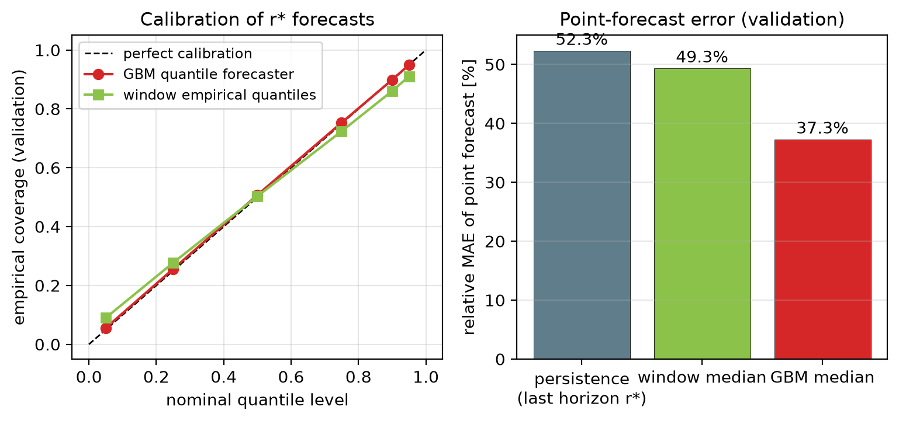

---

## 6. Key idea 3: the KKT (newsvendor) allocation rule

### 6.1 The newsvendor problem in one paragraph

A newspaper seller must decide in the morning how many papers to stock, without
knowing how many will sell. Stock too few and you lose sales; stock too many
and they go to waste. The classic answer: stock up to the quantile of demand
where the chance of selling one more paper exactly balances its cost. With
**several products and one shared budget** (the "constrained multi-item
newsvendor", Hadley and Whitin, 1963), all products are stocked up to the point
where the **value of one more unit is the same** for all of them.

Our version: products = cells, stock = budget, shared budget = link capacity.

### 6.2 The objective

For one interval, with forecast distribution $F_i$ of $r^*_i$:

$$\max_{r} \sum_i w_i \, \mathbb{E}\big[\min(B_i + r^*_i,\; r_i)\big]
\quad \text{s.t.} \quad \sum_i r_i \le C,\; 0 \le r_i \le \text{cap}_i$$

"Maximise the priority-weighted amount of need that is actually covered, on
average under the forecast." The expected served amount
$\mathbb{E}[\min(\cdot, r)]$ is **concave** in r (each extra bit of budget is
worth less than the previous one). Its slope is $w_i (1 - F_i(r - B_i))$:
the weight times the **probability that the next bit of budget is actually
needed**.

### 6.3 The solution

Because the problem is separable and concave, the **KKT conditions** (the
standard optimality conditions for constrained problems; KKT =
Karush–Kuhn–Tucker) give the global optimum in closed form:

$$\boxed{\; r_i(\lambda) = \text{clip}\Big(B_i + F_i^{-1}\big(1 - \lambda / w_i\big),\; 0,\; \text{cap}_i\Big)\;}$$

* **λ** is a single number (a "price" of link capacity), the same for every
  cell. It is found by **60 steps of bisection** so that the budgets add up
  exactly to C.
* If the link is not full (the constraint is not binding), λ = 0 and every
  cell gets its full predicted range, with the surplus shared out as headroom.
* F⁻¹ is the straight-line interpolation through the six forecast quantiles.
* Cost: O(N·K + N·iterations), a few tens of microseconds for 8 cells.

### 6.4 What the formula means (the sentence to say on stage)

> **Every cell is cut at the same priority-weighted risk.** A cell with a wide
> (uncertain) forecast or a high priority automatically gets more margin above
> its median. A cell with a confident forecast gets about its median. The
> backlog is always funded first. **Margins are derived, not tuned.**

### 6.5 A toy example

Two cells, link C = 10.

* LL cell (w = 3): its level is 1 − λ/3.
* eMBB cell (w = 1): its level is 1 − λ.

Say bisection finds λ = 0.6. Then the LL cell is funded up to its **80 %**
forecast quantile (1 − 0.6/3 = 0.8) and the eMBB cell up to its **40 %**
quantile (1 − 0.6 = 0.4). If those quantiles are 4 and 6, the budgets are
4 + 6 = 10 = C. The high-priority, bursty cell gets a generous margin; the
tolerant cell runs a bit below its median. Note that if λ ≥ w for a cell (here
λ ≥ 1 for eMBB), its level drops to 0 or below and it gets only its backlog.
This "saturation" explains a finding of the extended study (Section 9.5).

### 6.6 The four propositions (proved in `docs/fhlm/method.md`, checked by tests)

| # | Name | In plain words |
|---|---|---|
| 1 | Feasibility | Whatever the forecast, the budgets fit within the caps and add up to at most C. The link is never overloaded. |
| 2 | Equal weighted tail probability | At the optimum every cell has the same w_i × P(needs more). With a single-number forecast, the rule reduces to filling cells in priority order, which is why the point-forecast controller is the fair comparison. |
| 3 | Backlog first | Bits already waiting are funded before any uncertain future demand of an equal- or lower-weight cell. |
| 4 | Robustness to a wrong forecast | If the forecast distribution is off by at most ε everywhere (Kolmogorov distance), the loss is at most 2·ε·w_max·C. It grows **linearly** in ε, so a somewhat wrong forecast degrades gently. |

Be precise about what these are: properties of the **one-interval** problem.
There is **no** claim about closed-loop optimality or queue stability.

### 6.7 The whole control loop

```
 delayed state (1 ms old)  ->  28 features per cell  ->  6 GBM quantiles of r*  ->  KKT rule (bisection on λ)
        ^                                                                                     |
        |                                                                            budgets r_i, held 10 ms
        |                                                                                     v
 FIFO queues, drops after D  <-  shared link (never overloaded)  <-  DU schedulers send floor(r_i/β) PRB-layers
        ^
  traffic a_i(t), η_i(t)
```

**Edge cases:** if the forecast is not a finite number, fall back to window
quantiles; zero demand gets zero budget plus a share of headroom; a link that
is not full gives every cell its full predicted range.

**Calibrated variant (an ablation):** an online rule called **adaptive
conformal inference (ACI)** (Gibbs and Candès, 2021) shifts each cell's
quantile level up after a miss and down after a hit. It is reported as an
ablation because it **did not help** (Section 8.5).

---

## 7. How the experiments were run

### 7.1 The controllers compared (all knobs tuned on validation seeds)

| Controller | How it estimates r\* | How it splits the link | Why it is in the study |
|---|---|---|---|
| Static equal share | does not | C / 8 each | Floor: no intelligence |
| Reactive proportional | running average of demand (EWMA), ignores deadlines | proportional | Simple, common practice |
| MaxWeight | uses priority × queue length, head-of-line-age urgency | largest weight first | Textbook queue-based scheduler |
| Deadline-aware reactive | last observed r\* (persistence) | deadline-weighted water-fill | **Strong non-ML baseline**: knows deadlines |
| Point forecast | GBM **median** | deadline-weighted water-fill | **Key ablation**: same model, one number |
| Fixed global quantile | GBM quantile, one tuned level (0.75) for everyone | water-fill | Tests whether "just use a quantile" is the trick |
| Proposed (window) | empirical quantiles of the last 30 intervals, **no ML** | KKT rule | Tests whether ML is needed |
| **Proposed** | **GBM quantiles** | **KKT rule** | The method |
| Proposed + ACI | GBM quantiles + online calibration | KKT rule | Calibration ablation |
| Oracle water-fill | **true** r\* (impossible in practice) | water-fill | Reference: perfect single number |
| Oracle + KKT | **true** r\* | KKT rule | Reference: how much is forecast error |

"**Water-fill**" means: give every cell what it asks for if possible and
redistribute what is left; under shortage, split in proportion to
weight × demand.

**Fair tuning:** margins {0, 0.25, 0.5}, running-average windows {20, 60} and
persistence windows {1, 3, 6} were tuned on validation seeds. **Margin 0 was
best for every baseline**: inflating a single estimate hurts when a shortage is
split proportionally, because over-claiming cells get more. Every baseline
redistributes unused capacity. The deadline-aware reactive controller uses the
same weights, backlog rate and water-fill as the point-forecast one.

### 7.2 Traffic: two independent families

**Family S (synthetic, deliberately bursty).** Per cell: a smooth Gamma
background, plus ON/OFF bursts with **heavy-tailed (Pareto) durations**
(α_on = 1.5, α_off = 1.8, following Willinger et al. 1997, the classic model of
bursty internet traffic), plus slow load changes about every second, plus
drifting spectral efficiency. Five scenarios:

| Scenario | Mean load | What is special |
|---|---|---|
| low | 0.50 | |
| moderate | 0.65 | |
| high | 0.80 | the main stress test |
| flash crowds | 0.80 | short 1.8× overloads 15 % of the time |
| **shift (held-out)** | 0.80 | bursts 1.5× stronger and longer, heavier tail; **never seen in training or tuning** |

**Family G (standards-based: nothing hand-designed).** Built only from 3GPP
models: the TR 38.901 urban-macro channel (7 interfering sites, shadowing,
Jakes fading at 3 km/h), TS 38.214 link adaptation (CQI table), FTP Model 3
file downloads for eMBB cells (TR 36.814), XR video at 60 fps for LL cells
(TR 38.838). Fronthaul demand is the output of a round-robin PRB scheduler.
Own forecaster, own tuning. Scenarios: moderate 0.65 and high 0.80.

Why two families? A reviewer would say "you designed the traffic your method
likes". Family G answers that.

### 7.3 Protocol and statistics, explained simply

* **20 test seeds × 20,000 slots (10 s each)** after 1,000 warm-up slots.
* **Every controller sees exactly the same traffic and the same delayed
  observations, seed by seed.** This lets us compare them **in pairs**, which
  removes the noise from "this seed happened to be burstier".
* **Paired bootstrap 95 % confidence interval.** Resample the 20 per-seed
  differences many times to see how much the average reduction could vary.
* **Wilcoxon signed-rank test.** Checks whether the proposed rule is
  consistently better across seeds, without assuming a bell curve.
* **Holm correction.** Because we compare against many baselines, we tighten
  the p-values so we do not "find" a win by luck.
* Main comparison = 10 controllers × 5 scenarios × 20 seeds = **1,000 runs**
  (plus 100 oracle+KKT runs and 480 Family G runs).

---

## 8. Results

### 8.1 Main result, Family S ($V_w$ in %, mean ± std over 20 seeds; lower is better)

| Method | low 0.50 | moderate 0.65 | high 0.80 | flash crowds | shift (held-out) |
|---|---|---|---|---|---|
| Static equal share | 4.45 ± 1.05 | 9.65 ± 1.36 | 15.46 ± 1.51 | 19.15 ± 2.34 | 22.31 ± 2.99 |
| Reactive proportional | 0.83 ± 0.27 | 4.11 ± 0.69 | 9.20 ± 0.99 | 12.27 ± 2.23 | 11.70 ± 2.24 |
| MaxWeight | 0.90 ± 0.28 | 4.85 ± 0.79 | 11.54 ± 1.27 | 15.24 ± 3.02 | 12.31 ± 2.44 |
| Deadline-aware reactive | 0.52 ± 0.21 | 4.24 ± 0.78 | 11.03 ± 1.33 | 14.51 ± 3.06 | 12.56 ± 2.81 |
| Point forecast (GBM median) | 0.27 ± 0.17 | 3.23 ± 0.73 | 9.70 ± 1.34 | 13.33 ± 3.09 | 11.30 ± 2.81 |
| Fixed global quantile (0.75) | 0.34 ± 0.23 | 4.35 ± 1.02 | 11.76 ± 1.44 | 15.09 ± 3.17 | 12.85 ± 3.32 |
| Proposed, window quantiles (no ML) | 0.25 ± 0.13 | 2.57 ± 0.64 | 8.72 ± 1.34 | 12.67 ± 3.19 | 10.22 ± 2.88 |
| **Proposed (GBM quantiles + KKT)** | **0.15 ± 0.13** | **2.15 ± 0.60** | **8.00 ± 1.27** | **11.76 ± 3.08** | **10.04 ± 2.71** |
| Proposed + ACI calibration | 0.17 ± 0.13 | 2.17 ± 0.61 | 8.14 ± 1.30 | 12.27 ± 3.26 | 11.12 ± 3.22 |
| *Oracle water-fill (not implementable)* | *0.07* | *1.62* | *6.89* | *10.16* | *6.69* |

**Headline: the proposed rule is the best implementable controller in all 5
scenarios.**

Why are the standard deviations large and overlapping? Because they mostly
reflect burst timing, which every controller shares on the same seed. The
paired comparison below is the right way to read the result.

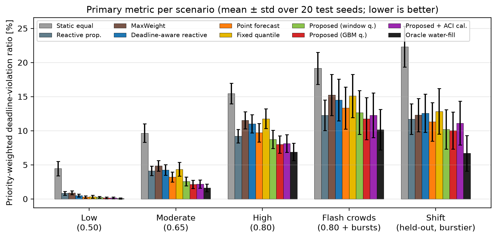

### 8.2 Paired, seed-by-seed reduction by the proposed rule (Family S)

Mean relative change of $V_w$, seeds won out of 20. ** = Holm-corrected
Wilcoxon p < 0.01, * = p < 0.05.

| Proposed vs. | low | moderate | high | flash crowds | shift |
|---|---|---|---|---|---|
| Reactive proportional | −81 % 20/20** | −48 % 20/20** | −13 % 20/20** | **−4 % 16/20\*** | −14 % 20/20** |
| MaxWeight | −83 % 20/20** | −56 % 20/20** | −31 % 20/20** | −23 % 20/20** | −18 % 20/20** |
| Deadline-aware reactive | −70 % 20/20** | −49 % 20/20** | −27 % 20/20** | −19 % 20/20** | −20 % 20/20** |
| Point forecast | −43 % 20/20** | −33 % 20/20** | −18 % 20/20** | −12 % 20/20** | −11 % 20/20** |
| Fixed global quantile | −54 % 20/20** | −50 % 20/20** | −32 % 20/20** | −22 % 20/20** | −22 % 20/20** |
| Window quantiles (no ML) | −37 % 20/20** | −16 % 20/20** | −8 % 20/20** | −7 % 20/20** | **−2 % 16/20\*\*** |
| + ACI calibration | −9 % 18/20** | −1 % 16/20** | −2 % 19/20** | −4 % 20/20** | −10 % 20/20** |

* **Strongly supported:** against the point forecast, the fixed quantile,
  MaxWeight and the deadline-aware reactive controller, the proposed rule wins
  in every scenario (including the held-out shift), **on every seed**, p < 0.01.
* **Weak spot:** against plain reactive proportional under flash crowds, only
  −4 % (16/20 seeds, p = 0.03). There, proportional starves the LL cells
  (17.8 % LL violations vs 4.6 %) but serves eMBB much better (7.1 % vs
  18.3 %), so the weighted score barely moves.

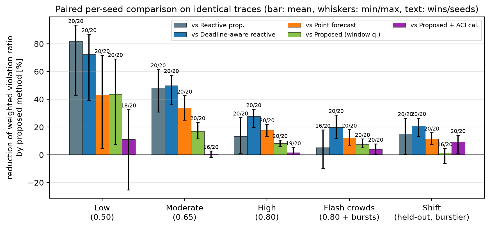

### 8.3 Where the gain comes from (scenario high, 20 seeds)

| Method | LL violations | eMBB violations | Utilisation | Jain fairness |
|---|---|---|---|---|
| Reactive proportional | 14.7 % | 4.0 % | 74.7 % | 0.996 |
| MaxWeight | 20.6 % | 2.9 % | 74.1 % | 0.991 |
| Deadline-aware reactive | 5.2 % | 16.5 % | 69.3 % | 0.995 |
| Point forecast | 3.1 % | 16.0 % | 70.1 % | 0.994 |
| Fixed global quantile | 0.9 % | 22.0 % | 67.0 % | 0.985 |
| **Proposed** | 3.4 % | **12.3 %** | **72.2 %** | 0.997 |
| Oracle water-fill | 0.04 % | 13.4 % | 72.3 % | 0.994 |

The story in this table:

1. **Deadline-unaware controllers sacrifice the LL cells** (14.7 %, 20.6 %).
   A large queue is not the same as an urgent queue.
2. **Every deadline-aware controller protects LL** and pays with eMBB.
3. **Among them, the proposed rule loses the least eMBB and has the highest
   utilisation**, because it adds margin only where the forecast is wide (LL
   cells at burst onset) and lets confident cells sit at their median.
4. **One global level (fixed quantile) over-protects LL** (0.9 %) and wastes
   33 % of the allocation, giving the worst eMBB loss. So the per-cell level
   chosen by the link constraint is what matters, not merely "using a
   quantile".
5. Even the oracle loses 13 % of eMBB bits: budgets fixed for 10 ms cannot
   follow heavy bursts. That is why absolute numbers are high.
6. Fairness is > 0.98 for everyone, so it is not a differentiator.

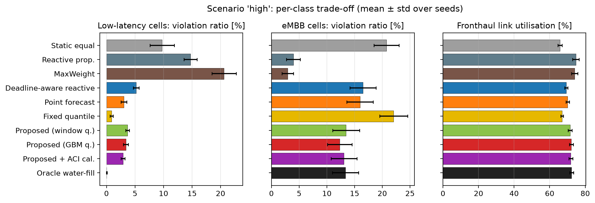

### 8.4 The rule in action: one LL cell

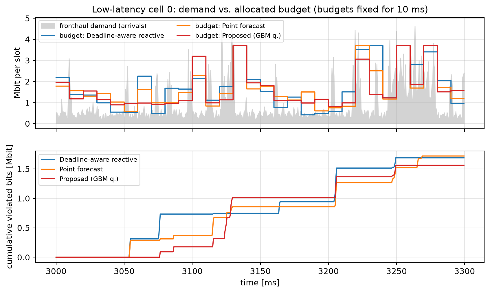

How to read it: grey is the demand of one LL cell; the step lines are budgets
held for 10 ms. The reactive controller (blue) is **one interval late** at
every burst: it raises the budget after the burst has already happened. The
proposed rule (red) raises the budget where the forecast range is **wide**
(burst onset). The bottom panel is cumulative violated bits: the proposed rule
ends with the fewest over this trace. (Honest note: it is not ahead at every
moment; around 3,130 ms it is briefly worse. It wins over the whole trace.)

### 8.5 Ablations: which piece carries the gain?

1. **Range vs single number** (same model, same rule family): −11 % to −43 %,
   20/20 seeds everywhere. **Representing uncertainty matters.**
2. **Per-cell KKT level vs one tuned global level** (same forecast): −22 % to
   −54 %. **The level must be chosen per cell by the link constraint.**
3. **ML vs non-ML quantiles** under the same KKT rule: the boosted trees add
   −7 % to −37 % on normal traffic, but only −2 % under the held-out shift.
   **Most of the gain is the rule (the r\* target plus the KKT split), not the
   model. ML is useful, not necessary.** The window-quantile version is the
   robust fallback.
4. **Online ACI calibration: no gain** (1–9 % worse on normal traffic, 10 %
   worse under shift). Why: in a **coupled** allocation, LL misses are partly
   **caused by the shortage split**, not by a biased forecast. Calibration
   then inflates LL reservations and starves eMBB (under shift: LL 4.7 % vs
   6.7 %, but eMBB 17.2 % vs 13.2 %). Per-stream conformal correction does not
   carry over to coupled cells. This is a negative result, reported honestly.

### 8.6 Family G (3GPP traffic): does it reproduce?

| Method | moderate 0.65 | high 0.80 | unweighted (high) |
|---|---|---|---|
| Static equal | 10.75 | 13.10 | 19.2 |
| Reactive proportional | 12.05 | 15.94 | 15.0 |
| MaxWeight | 17.51 | 25.79 | 19.7 |
| Deadline-aware reactive | 8.95 | 11.53 | 18.5 |
| Point forecast | 6.00 | 8.98 | 16.6 |
| Fixed quantile | 6.80 | 9.88 | 18.7 |
| Window quantiles | 6.18 | 9.01 | 16.0 |
| **Proposed** | **5.08** | **8.01** | **14.4** |
| Transfer (forecaster trained on Family S) | 6.99 | 9.89 | 14.3 |
| *Oracle + KKT* | *3.47* | *6.06* | *11.1* |

* **Yes, it reproduces** on traffic we did not design: best implementable at
  both loads, 20/20 seeds.
* At high load: −11 % vs point forecast, −31 % vs deadline-aware reactive,
  −50 % vs reactive proportional.
* Here it is also best under the **unweighted** ratio.
* The forecaster trained on Family S and applied unchanged to 3GPP traffic
  still beats every reactive controller, but not the in-family point forecast.
* Deadline-unaware controllers do even worse than static sharing here: an FTP
  file is a burst at full cell rate and XR frames are periodic, so "large
  queue" and "urgent queue" are very different.

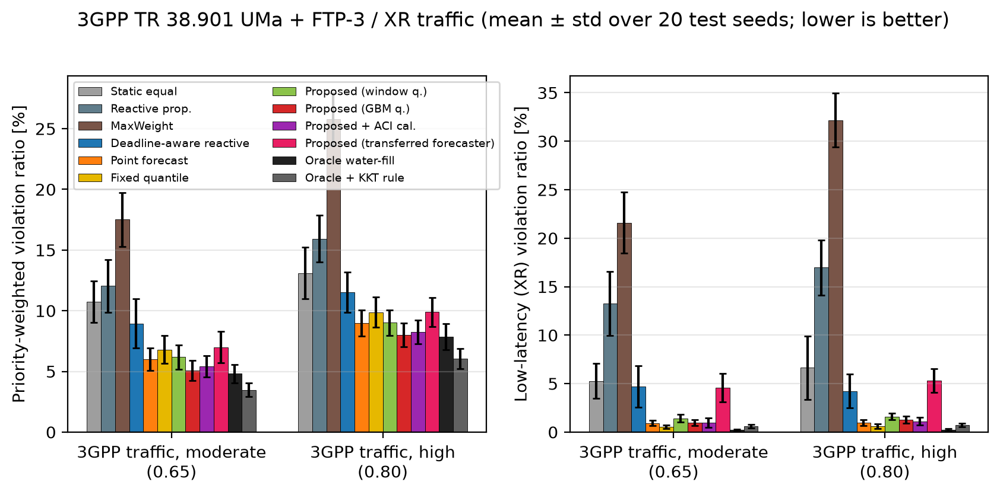

### 8.7 Honest caveat: the gain is a priority trade

**Unweighted** violation ratio, Family S (%):

| Method | moderate | high | flash crowds |
|---|---|---|---|
| Reactive proportional | **2.44** | **6.55** | **9.64** |
| MaxWeight | 2.73 | 7.18 | 10.44 |
| Point forecast | 3.93 | 12.88 | 17.62 |
| Proposed (run with w_LL = 3) | 2.50 | 10.19 | 15.08 |

If every bit counts the same, plain proportional sharing loses **fewer total
bits** at moderate and high load in Family S, because it sacrifices the small
LL cells to serve eMBB volume.

**LL-weight sweep** (S high, every controller told the new weight, $V_w$ %):

| w_LL | 1 | 2 | 3 (default) | 5 |
|---|---|---|---|---|
| Reactive proportional | **6.55** | **8.13** | 9.20 | 10.56 |
| Point forecast | 6.77 | 8.90 | 9.70 | 10.57 |
| Proposed | 6.58 | 8.35 | **8.00** | **6.93** |

The rule ties with proportional at w_LL = 1 and pulls ahead from w_LL = 3. In
Family G at w_LL = 1 it is clearly **worse** than the point forecast (15.9 %
vs 10.4 %): 3GPP demand is often exactly zero in a horizon (no file, no
frame), so at a low common risk level the newsvendor reserves nothing beyond
backlog for many cells, an all-or-nothing allocation. With a perfect forecast
(oracle + KKT) it would win at every weight, so that loss is forecast error.

**Scope of the claim: operators who value a low-latency bit at least 2–3× an
eMBB bit.** Say this before you are asked.

### 8.8 How much is still forecast error? (oracle + KKT)

| Scenario | Proposed | Oracle + KKT | Gap (share of the proposed rule's loss) |
|---|---|---|---|
| S low | 0.15 | 0.05 | 70 % |
| S moderate | 2.15 | 0.88 | 59 % |
| S high | 8.00 | 4.77 | 40 % |
| S flash crowds | 11.76 | 8.10 | 31 % |
| S shift | 10.04 | 5.84 | 42 % |
| G moderate | 5.08 | 3.47 | 32 % |
| G high | 8.01 | 6.06 | 24 % |

* Oracle + KKT is the same rule fed a perfect forecast of r\*. The gap is what
  a better forecaster could still buy: **24–40 % at high load**. The rest is
  the unavoidable cost of committing budgets for 10 ms.
* At T = 2 ms, oracle + KKT reaches 1.91 % against 6.89 % for oracle
  water-fill with **the same perfect information**. **The allocation rule
  matters as much as the forecast.**
* So "oracle" is a **reference, not an upper bound**. Never call it a bound.

### 8.9 Sensitivity: control interval T and telemetry delay τ

These sweeps use scenario high with **10 seeds** and forecasters retrained for
each setting. That is why the T = 10 ms row (7.71 %) differs slightly from the
main table (8.00 %, 20 seeds). If someone spots this, that is the reason.

| T | Reactive prop. | Deadline-aware | Point forecast | Proposed | Oracle water-fill |
|---|---|---|---|---|---|
| 2 ms | 3.91 | 7.89 | 6.57 | **3.07** | 6.89 |
| 5 ms | 7.42 | 10.20 | 7.53 | **5.07** | 6.01 |
| 10 ms | 8.91 | 10.78 | 9.46 | **7.71** | 6.63 |
| 20 ms | **11.80** | 15.84 | 14.08 | 13.15 | 10.83 |

| τ | Reactive prop. | Proposed | Proposed vs reactive prop. |
|---|---|---|---|
| 0 ms | 8.16 | 6.85 | −16 % |
| 1 ms (default) | 8.91 | 7.71 | −13 % |
| 2.5 ms | 9.86 | 8.77 | −11 % |
| 5 ms | 11.30 | 11.07 | −2 % |

* **Short interval:** the rule even beats the oracle water-fill (−55 % at
  2 ms).
* **T = 20 ms (5× the LL deadline):** reserving the LL peak rate for the whole
  interval over-reserves, and plain proportional wins (+11 %).
* **τ = 5 ms (2.5× the LL deadline):** the advantage over proportional
  shrinks to 2 %. The ordering against the deadline-aware controllers stays
  the same at every τ.
* **Regime of validity:** intervals of up to a few multiples of the shortest
  deadline, with reasonably fresh telemetry.

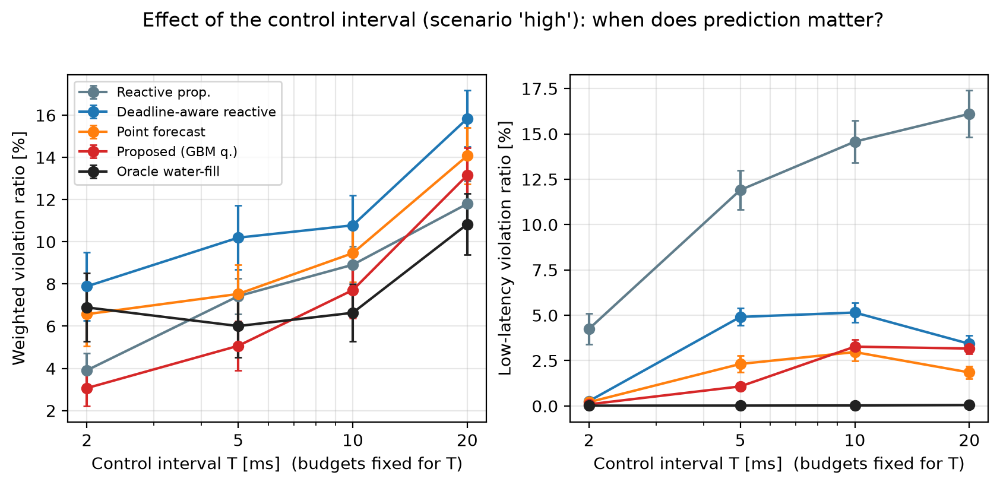

### 8.10 Robustness to a miscalibrated forecast (Proposition 4 in practice)

Every forecast quantile level is deliberately shifted by ε before allocation
(ε < 0: under-reserve; ε > 0: over-reserve):

| ε | −0.3 | −0.1 | 0 | +0.1 | +0.3 |
|---|---|---|---|---|---|
| high | 7.80 | 7.61 | 7.71 | 8.13 | 9.45 |
| shift | 10.96 | 11.10 | 11.13 | 11.53 | 12.50 |

Point forecast: 9.46 / 12.42. Deadline-aware reactive: 10.78 / 13.68.

* **Under-reserving is almost harmless**: a common shift of every cell is
  absorbed by λ.
* **Over-reserving degrades gradually** (+23 % at ε = +0.3, high load).
* Even then, the rule only falls back to the point-forecast level and still
  beats the deadline-aware reactive controller.

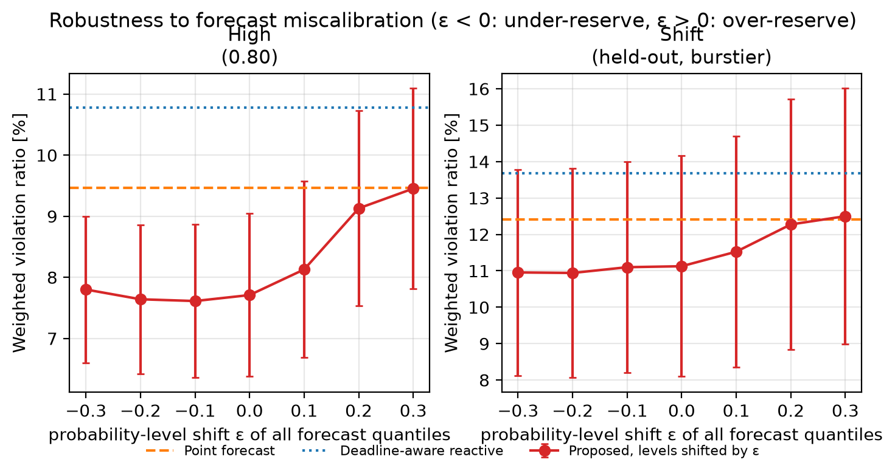

### 8.11 Part A × Part B: compression width vs allocation rule

Same user traffic (scenario moderate, 10 seeds). Only the BFP mantissa width
changes, which changes β and therefore the load:

| BFP width | Load on link | Reactive prop. | Point forecast | Proposed |
|---|---|---|---|---|
| 6 bits | 0.44 | 0.22 | 0.15 | **0.11** |
| 9 bits (default) | 0.65 | 3.90 | 3.00 | **1.96** |
| 12 bits | 0.86 | **11.37** | 12.50 | 12.01 |
| 14 bits | 0.99 | **17.29** | 19.16 | 20.81 |

* **Compression sets the regime; allocation decides the loss inside it.**
* At 0.44 load almost nothing is lost whatever you do.
* At 0.65 the proposed rule loses **about half** as much as the reactive
  controllers. **Allocation matters most between about 0.5 and 0.8 load.**
* At 0.86 proportional is already slightly better; at 0.99 no split helps.
  You need more compression or more capacity.
* Not modelled: the signal-quality cost of fewer bits. Part A's NMSE curves
  cover that side.

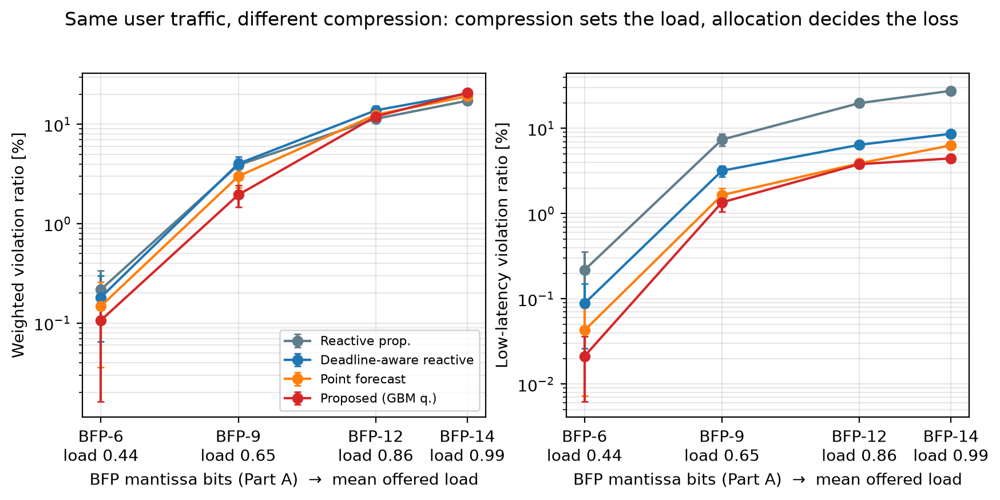

### 8.12 Decision overhead (Python, 4-core CPU, per 10 ms control interval)

| Controller | Time |
|---|---|
| Static | 0.02 ms |
| Reactive proportional | 0.04 ms |
| MaxWeight | 0.05 ms |
| Deadline-aware reactive | 0.09 ms |
| Window quantiles | 2.2 ms |
| Point forecast | 2.5 ms |
| **Proposed** | **3.5 ms** |

* The KKT rule itself takes **less than 0.1 ms**. The cost is building
  features and evaluating 6 × 300 trees for 8 cells.
* We wrote a vectorised numpy tree traversal (1.8 ms, versus 12 ms for
  scikit-learn's `predict`).
* A real O-DU would need a compiled model (C++/numba) or the no-ML window
  fallback. We do not claim a measured compiled number.

---

## 9. The extended study (theory and stronger controllers)

This was added after the NCC 2027 conference submission (6 pages), to turn it
into an 11-page journal-length manuscript (`paper/extended/`). It asks three
questions.

### 9.1 What is the real control problem?

Formally it is a **POMDP** (partially observed Markov decision process): the
state is every queue's age profile, the hidden traffic state and the spectral
efficiency; you act every T slots on information τ slots old; you want to
minimise the total weighted drops. That is **intractable** (hundreds of
continuous state dimensions, unknown traffic law, actions held for T slots).
There are three standard ways to approximate it, and all three were
implemented:

1. **One-step stochastic programs:** the KKT newsvendor rule (ours), on a
   learned or model-based distribution.
2. **Lyapunov drift / back-pressure:** MaxWeight, and **predictive MaxWeight**
   (Huang et al. 2016), which adds a look-ahead using the forecast median to
   the queue length.
3. **Direct policy search:** a 3-parameter policy learned from reward with the
   **cross-entropy method (CEM)**, a small analogue of a deep reinforcement
   learning xApp.

A third traffic family, **M**, was added: Markov-modulated Gamma sources with
three hidden phases (idle, normal, burst), and a **semi-Markov held-out shift**
with Pareto sojourns that breaks every Markov model.

### 9.2 Theory of r\* for Markov traffic (what to say, without the algebra)

* An exact expression for the "window log-moment generating function" of the
  traffic, and the **effective bandwidth** (a classical quantity that runs from
  the mean rate to the peak rate).
* A **Chernoff-union tail bound** on P(r\* > x).
* **Large-deadline decay:** as the deadline grows, the tail of r\* decays like
  classical buffer-overflow probabilities. This links r\* to textbook queueing
  theory.
* A pathwise **shortfall sandwich**, valid for any traffic:
  (D + 1)(r\* − r)⁺ ≤ dropped volume ≤ Σ (a_t − r)⁺. So the newsvendor
  objective is a **lower bound** on the violated volume.
* **Validation:** the sandwich is never violated; the bound is valid but
  **25–100× too conservative** at 2–10 ms deadlines. That looseness is the
  quantitative argument for **learning** the distribution instead of bounding
  it.

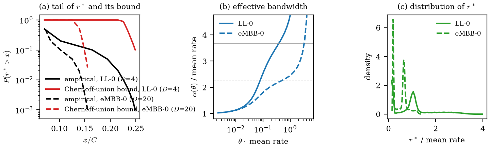

### 9.3 Extended results: best implementable controller ($V_w$ %)

| Scenario | GBM + KKT (ours) | Predictive MaxWeight | CEM policy | Markov-chain KKT | Tuned-weight KKT |
|---|---|---|---|---|---|
| S low 0.50 | 0.15 | 0.14 | **0.13** | 0.25 | 0.18 |
| S moderate 0.65 | 2.15 | **1.62** | 1.77 | 2.65 | 2.21 |
| S high 0.80 | 8.00 | **6.15** | 6.57 | 8.64 | 7.88 |
| S flash crowd | 11.76 | **9.69** | 10.20 | 12.44 | 11.49 |
| S shift | 10.04 | 10.25 | **9.73** | 10.22 | 9.90 |
| G moderate 0.65 | 5.08 | 7.57 | **4.58** | 6.44 | 4.98 |
| G high 0.80 | 8.01 | 11.36 | **7.17** | 8.77 | 7.83 |
| M moderate 0.65 | 0.92 | 1.64 | 0.88 | 1.24 | **0.85** |
| M high 0.80 | 4.94 | 4.79 | **3.93** | 5.12 | 4.88 |
| M shift 0.80 | 5.52 | 4.80 | **4.17** | 5.39 | 5.31 |

**Say this plainly, it is the honest bottom line:**

* Within the original (NCC) comparison set, the KKT rule still wins **all 10
  scenarios** across the three families, and it is the best controller with
  **nothing to tune**.
* **But two controllers that use the same forecaster beat it:** the CEM policy
  is best in **6/10**, predictive MaxWeight in **3/10** (all on the bursty
  Family S), and the KKT rule with one tuned weight in 1/10.
* A Markov chain fitted online, with **no training data**, is within 3–9 % of
  the learned rule.

### 9.4 What the CEM policy learned

Per-class quantile levels **p_LL ≈ 0.8 and p_eMBB ≈ 0.5**, with an internal LL
weight of about 1, and weighted water-filling. In other words: decouple the two
classes' levels instead of tying them through one λ.

### 9.5 Why re-tuning the LL weight inside the KKT rule does not close the gap

* Tuned weight: 8.00 → 7.88 (S high), 8.01 → 7.83 (G high), 4.94 → 4.88
  (M high). That is an order of magnitude less than the CEM gain.
* **The λ diagnostic** (high load, 3 seeds × 8,000 slots): the link is full in
  ~100 % of intervals (99.8 % S, 100 % G, 99.9 % M), and in **50–58 %** of
  them λ\* ≥ w_eMBB. Then every eMBB cell already sits at its lowest quantile
  (recall Section 6.5); the weight has nothing left to move.
* So the gap is **structural, not a wrong constant**: CEM wins by decoupling
  the per-class levels and using a different sharing rule.

### 9.6 Operating regime (when to use which approach)

* **Short control interval (T ≤ 5 ms):** reservation (the KKT rule) wins.
* **T = 10–20 ms with bursts shorter than the interval:** back-pressure
  (predictive MaxWeight) wins.
* **Long bursts (FTP files, XR frames, Family G):** reservation wins at every
  T.

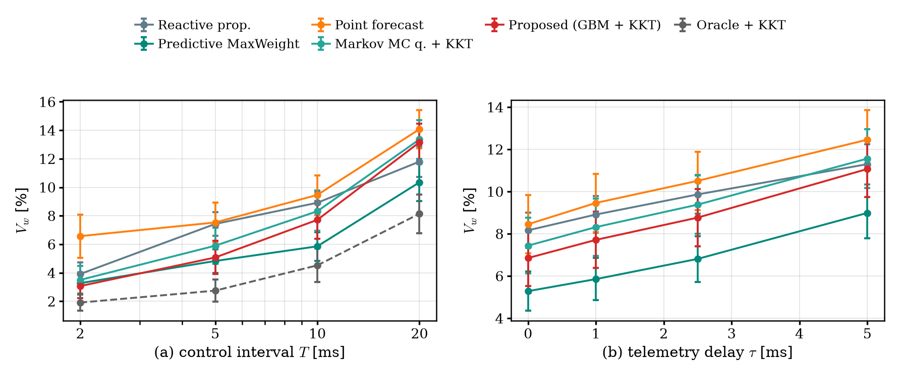

**Where this leads.** The extended study leaves two open questions: is the gap
to CEM and predictive MaxWeight caused by forecast error (B2 tests this with a
much better forecaster), and can one controller combine reservation and
back-pressure and beat both (B3)?

---

## 10. Part B2: a Bayesian, decision-focused Transformer forecaster

**The question B2 asks.** The extended study showed that two controllers beat
the KKT rule. Is that because our **forecast** is not good enough, or because
the **decision rule** itself has the wrong structure? B2 builds the best
forecaster we could and plugs it into the unchanged KKT rule. If the gap
closes, the forecast was the problem. (Spoiler: it barely closes, so the gap is
structural. That is what motivates B3.) B2 was run on **Family S only**.

### 10.1 Background from zero: Transformers and uncertainty

| Term | Meaning in one line |
|---|---|
| **Transformer** | A neural network built from "attention" layers; the standard model for sequences (text, time series). |
| **Attention** | Each element of the input looks at all the others and decides how much each one matters for its own output. |
| **Patch (PatchTST)** | Instead of feeding single time steps, cut the history into chunks ("patches") and treat each chunk as one token. Fewer, richer tokens. |
| **Cross-variate attention (iTransformer)** | Attention between different series (here: different cells) instead of between time steps. |
| **FiLM** | "Feature-wise linear modulation": scale and shift a layer's output using side information (here: deadline and priority), so one network serves both cell classes. |
| **Pinball loss** | The loss used to train a model to predict a quantile (same as for the GBM). |
| **Non-crossing quantiles** | The 5 % quantile must never exceed the 25 % one, and so on. Building each quantile as the previous one plus a positive amount guarantees it. |
| **Epistemic uncertainty** | Uncertainty because the model itself is unsure (not enough data, new situation), as opposed to randomness in the traffic. |
| **MC dropout** | Run the network several times with random neurons switched off; the spread of the outputs estimates epistemic uncertainty. |
| **Deep ensemble** | Train a few copies with different random seeds; their disagreement estimates epistemic uncertainty. |
| **Decision-focused learning** | Train the forecaster on the cost of the **decision** made with it, not on forecast accuracy. |
| **DAgger** | A training trick: re-collect training situations using the new model's own decisions, then retrain. |

### 10.2 The model: LCQT (link-aware cross-cell quantile Transformer)

It is a **drop-in replacement** for the GBM: same target (r\* of the coming
horizon), same six quantile levels, same train/validation/test seeds, and the
KKT rule is used unchanged. Pipeline:

1. **Deadline-aware patch tokens.** Each cell's history is cut into 16 patches
   of 22 slots (one horizon, T + τ). Each patch also carries its own r\* at the
   cell's deadline, plus its mean and max. A summary token carries the 28 GBM
   features.
2. **Temporal encoder.** 2 Transformer layers, width 48, 4 attention heads,
   shared by all cells.
3. **FiLM on (deadline, priority).** One network for LL and eMBB cells.
4. **Link-aware cross-cell attention.** One attention layer whose tokens are
   the 8 cells sharing the link. Idea: coinciding bursts across cells cause the
   shortages, and a per-cell model cannot see them.
5. **Non-crossing quantile head.** q₁ = softplus(a₁), q_k = q_{k−1} + softplus(a_k).

Size and cost: **63k parameters** (44k without the cross-cell layer), 40
epochs, early stopping on validation, about **6 minutes** on a 4-core CPU.

**What is new and what is not.** Every block is prior art (PatchTST,
iTransformer, Temporal Fusion Transformer, MC dropout, deep ensembles,
decision-focused learning). We found no paper that combines them for a shared,
deadline-constrained link. Say "we found none in our search", not "none
exists".

### 10.3 The two non-standard layers

**Bayesian mixture layer.** Three ensemble members × 8 dropout passes give 24
sampled forecasts per cell. The KKT rule receives their **mixture**
distribution (the average of the 24 CDFs), **not** the average of the
quantiles. Averaging quantiles throws away the disagreement between samples.
With the mixture, a cell whose forecast the model is unsure about gets a wider
margin at the same λ. Dropout is seeded per decision slot, so runs stay
reproducible.

**Differentiable KKT layer (DF-LCQT).** The KKT rule becomes the last layer of
the network, so the Transformer can be trained on the cost of the allocation
itself:

* Forward pass: bisection finds λ\* as usual.
* Backward pass: the implicit function theorem on the binding link,
  $\partial\lambda^\ast/\partial q = -(\partial g/\partial q)/(\partial g/\partial\lambda)$
  with $g = \sum_i r_i - C$, implemented as one Newton step.
* Loss: $\sum_i p_i (D_i + 1)(B_i + r^*_i - r_i)^+$ (the shortfall-sandwich lower
  bound on dropped bits from the extended study) plus a small pinball term.
* Training situations are logged by running the rule closed-loop on training
  seeds, then one DAgger round.
* Unit tests: matches the numpy allocator to 10⁻⁶, and the total budget does
  not change with the forecast when the link is full (budget only moves
  between cells).

### 10.4 Forecast quality (same validation rows for every model)

| Model | Pinball | Pinball LL | 90 % coverage | 90 % width | Shift: 90 % cov. | Shift: LL q95 cov. |
|---|---|---|---|---|---|---|
| GBM (B1) | 0.0224 | 0.0259 | 0.894 | 1.51 | — | — |
| LCQT | **0.0214** | 0.0251 | 0.902 | **1.36** | 0.795 | 0.855 |
| LCQT + MC dropout (16) | 0.0214 | 0.0251 | 0.911 | 1.41 | 0.802 | 0.870 |
| Deep ensemble (3) | **0.0212** | **0.0248** | 0.912 | 1.37 | 0.806 | 0.864 |
| **Ensemble × MC (3 × 8)** | 0.0213 | 0.0249 | **0.919** | 1.40 | **0.808** | **0.873** |
| DF-LCQT (decision-focused) | 0.0224 | 0.0273 | 0.907 | 1.38 | 0.830 | 0.822 |

* The Transformer cuts pinball loss by **4.5 %** and the 90 % interval width
  by **8 %**, at **higher** coverage than the GBM.
* The cross-cell layer and the priority-weighted loss do **not** improve the
  forecast (ablations equal within noise). An honest negative.
* The Bayesian layer moves coverage towards nominal under the held-out shift
  (LL 95 % quantile: 0.855 → 0.873) but cannot remove the under-coverage
  there: the shift is outside the training data.
* DF-LCQT gives up forecast accuracy **on purpose**: it shades the LL upper
  tail because that is cheaper for the decision.

### 10.5 Closed-loop results ($V_w$ %, Family S, 20 test seeds)

| Controller | low | moderate | high | flash | shift |
|---|---|---|---|---|---|
| GBM + KKT (B1) | 0.15 | 2.15 | 8.00 | 11.76 | 10.04 |
| LCQT median + water-fill | 0.25 | 3.14 | 9.76 | 13.47 | 11.51 |
| LCQT + KKT | 0.13 | 2.05 | 7.91 | 11.81 | 10.06 |
| MC-dropout LCQT + KKT | 0.12 | 2.04 | 7.93 | 11.82 | 10.03 |
| **Bayesian LCQT + KKT (3 × 8)** | **0.12** | **2.02** | **7.89** | 11.78 | 10.02 |
| DF-LCQT + KKT | 0.18 | 2.26 | 7.93 | 11.62 | 10.15 |
| CEM policy (extended study) | 0.13 | 1.77 | 6.57 | 10.20 | 9.73 |
| Predictive MaxWeight | 0.14 | 1.62 | 6.15 | 9.69 | 10.25 |
| Oracle + KKT (true r\*) | 0.05 | 0.88 | 4.77 | 8.10 | 5.84 |

**Bayesian LCQT vs GBM + KKT, paired:** −20.8 % (low), −6.1 % (moderate),
−1.4 % (high), each **20/20 seeds**; flash +0.2 % and shift −0.2 % are not
significant. Against plain LCQT, the Bayesian layer adds −0.2 % to −5.3 % in
all 5 scenarios (p < 0.03).

What carries the gain: the **patch Transformer** (main gain), the **Bayesian
mixture** (small but consistent). The **cross-cell layer** and
**priority-weighted loss** add nothing. **DF-LCQT** is −1.2 % under flash
crowds (p < 10⁻³) but +14 % at low load: its one-horizon training cost ignores
how queues carry over between intervals.

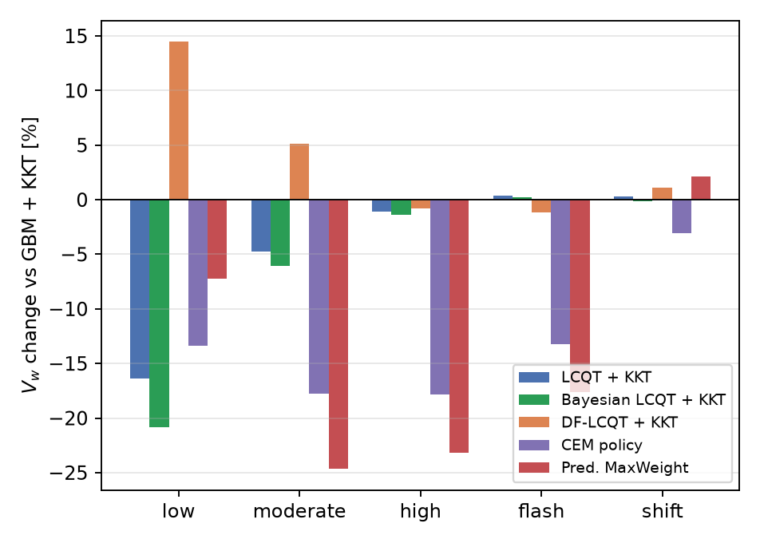

### 10.6 B2: honest assessment

**What improved**

* The Bayesian LCQT improves the proposed method on **every seed** at low to
  high load and never loses significantly.
* Best calibration under the shift.
* LCQT alone is **cheaper per decision** than the GBM (2.7 ms vs 3.5 ms).
* The differentiable KKT layer works and is unit-tested; the validation
  decision loss fell 9 % after DAgger.

**What did not**

* Gains are small at high load (−1.4 %), while CEM and predictive MaxWeight
  are still 14–28 % better. **The gap is structural, not forecast error**,
  confirming the extended-study diagnosis.
* The decision-focused gain on validation did not carry over to test seeds at
  low and moderate load.
* The Bayesian layer costs **17–21 ms** per decision in Python, longer than the
  10 ms interval. It needs batched or compiled inference on a real O-DU.
* Family S only; Families G and M were not run for B2.

**The sentence to say:** "A better forecaster helps a little; to beat the
strongest baselines we have to change the decision structure. That is B3."

---

## 11. Part B3: the back-pressure newsvendor (BPN)

**The question B3 asks.** Keep the forecaster, change the decision rule: can
one controller beat **both** strongest baselines (predictive MaxWeight and the
CEM class-level policy) everywhere?

### 11.1 Background from zero: back-pressure

**Back-pressure** (the idea behind MaxWeight) serves first the queues with the
largest "pressure", roughly priority × queue length. It is a classic,
provably stable way to schedule queues (Lyapunov drift theory). **Predictive
MaxWeight** adds a look-ahead: pressure = queue + a few horizons of the
forecast median. It uses a single forecast number and ignores deadlines.

### 11.2 Why the KKT rule loses to back-pressure (S high, 20 seeds)

| Controller | $V_w$ | LL viol. | eMBB viol. | Link util. |
|---|---|---|---|---|
| KKT rule (GBM) | 8.00 | 3.4 | 12.3 | 72.2 |
| CEM class-level | 6.57 | 6.0 | 7.1 | 74.7 |
| Pred. MaxWeight (CEM-tuned) | 5.98 | 6.0 | 5.9 | 75.5 |
| **BPN v1** | **5.23** | 5.5 | 4.9 | **76.1** |
| **BPN v2** | 5.32 | 5.8 | **4.8** | **76.1** |
| Oracle + KKT | 4.77 | 0.1 | 9.2 | 74.8 |

The diagnosis in one sentence: **a budget is a per-cell cap, so capacity
reserved for a 2 ms cell's upper quantile and then not used is lost.** The KKT
rule over-protects LL (3.4 %), starves eMBB (12.3 %) and uses the link least
(72.2 %). Back-pressure fills the link in queue order with median demands and
wastes less, but it ignores deadlines and forecast uncertainty.

**The idea:** fill a base in back-pressure order, **then** spend the leftover on
newsvendor margins.

### 11.3 How BPN decides (two stages, every 10 ms)

**Stage 1: base, back-pressure sharing.**

* Base rate: $b_i = a \cdot Q_i/T + (1-a)\cdot B_i$. It mixes MaxWeight's
  "drain the queue" rate ($a = 1$) with the KKT rule's deadline-aware backlog
  rate ($a = 0$).
* Base demand: $d_i = b_i + (1+\mu)\,\hat F_i^{-1}(p^0_{\text{class}})$: the base
  plus a class-level forecast quantile (one level for LL, one for eMBB), with a
  margin μ.
* Under shortage, capacity is shared in proportion to
  $v_{\text{class}}\,(\pi_i/\bar\pi)^{\eta}$, where $\pi_i = Q_i + \ell H m_i$ is
  the predictive back-pressure score (queue + ℓ horizons of forecast median).
  **η = 0** means class-weighted water-fill (reservation); **η = η_max (6)**
  means strict back-pressure order (greedy).

**Stage 2: leftover capacity by the KKT rule.**

$$r_i = \max\Big(r_i^{(1)},\; b_i + \hat F_i^{-1}\big(1 - \lambda/\omega_{\text{class}}\big)\Big), \qquad \sum_i r_i = C$$

**Key design property:** with the right parameters BPN becomes **exactly**
predictive MaxWeight ($a = 1$, $p^0 = 0.5$, η = η_max) or exactly the CEM
class-level policy ($a = 0$, η = 0, class levels). This is unit-tested. So the
policy class **contains both strongest baselines**: a search over it can only
match or beat them on the training cost.

### 11.4 How the 8 parameters are learned, fairly

* Parameters: $(p^0_{LL}, p^0_{eMBB}, v_{LL}, \ell, \omega_{LL}, a, \eta, \mu)$.
* Learned by the **cross-entropy method (CEM)** on **training seeds only**
  (8 episodes, same budget as the baselines' search).
* Two starting points: the tuned optimum of each contained baseline.
* The baselines were **re-tuned with the same CEM search** ("CEM-tuned"), so
  tuning effort is equal. Say this; it pre-empts "you tuned yours more".
* **v1 vs v2:** BPN v1 (6 parameters) always used strict back-pressure in
  stage 1. BPN v2 (8 parameters) adds the sharing exponent η and the margin μ
  so it also contains the reservation policy.

**What the search learned (and why that is interesting):**

| Family | η | a | (p⁰_LL, p⁰_eMBB) | Reading |
|---|---|---|---|---|
| S (bursty, short bursts) | 6 (greedy) | 0.98 | (0.41, 0.45) | back-pressure |
| G (3GPP: FTP files, XR frames) | 0 | 0.31 | (0.94, 0.73) | reservation |
| M (Markov) | 0 | 0.34 | (0.84, 0.31) | reservation |

The search **rediscovered the regime map** of the extended study on its own:
back-pressure for short bursts, reservation for long ones. That makes the
result interpretable, not a black box.

### 11.5 Results, Family S ($V_w$ %, 20 test seeds)

| Forecaster | Controller | low | moderate | high | flash | shift |
|---|---|---|---|---|---|---|
| GBM | KKT rule (B1) | 0.15 | 2.15 | 8.00 | 11.76 | 10.04 |
| GBM | Pred. MaxWeight (grid-tuned) | 0.14 | 1.62 | 6.15 | 9.69 | 10.25 |
| GBM | Pred. MaxWeight (CEM-tuned) | 0.16 | 1.66 | 5.98 | 9.36 | 10.46 |
| GBM | CEM class-level (re-searched) | 0.13 | 1.73 | 6.58 | 10.23 | 9.76 |
| GBM | BPN v1 (6 param.) | 0.10 | 1.21 | 5.23 | 8.58 | 9.23 |
| GBM | BPN v2 (8 param.) | 0.10 | 1.21 | 5.32 | 8.70 | 9.26 |
| LCQT | BPN v2 | 0.08 | 1.16 | 5.25 | 8.59 | 9.24 |
| Bayesian LCQT | BPN v1 | 0.08 | **1.11** | **5.05** | **8.34** | **8.92** |
| Bayesian LCQT | **BPN v2** | **0.07** | 1.12 | 5.21 | 8.55 | 9.12 |
| — | Oracle + KKT (true r\*) | 0.05 | 0.88 | 4.77 | 8.10 | 5.84 |

* With the **same** forecaster, BPN beats both strongest baselines in every
  scenario. At high load it is within **6–10 %** of the oracle-informed KKT
  rule.
* The B2 Transformer now pays off: it helps BPN more than it helped the KKT
  rule.
* **Be ready for this question:** on Family S, BPN v1 is slightly better than
  v2 (5.23 vs 5.32 at high load). v2 is the headline version because it is the
  one that also works on Family G (next table).

### 11.6 Generalisation: Families G (3GPP) and M (Markov), GBM forecaster

| Controller | G moderate | G high | M moderate | M high | M shift |
|---|---|---|---|---|---|
| KKT rule (B1) | 5.08 | 8.01 | 0.92 | 4.94 | 5.52 |
| Pred. MaxWeight (CEM-tuned) | 6.75 | 10.02 | 1.61 | 4.82 | 4.82 |
| CEM class-level (extended study) | 4.58 | 7.17 | 0.88 | 3.93 | 4.17 |
| CEM class-level (re-searched) | 4.51 | 7.05 | 0.94 | 3.94 | 4.22 |
| BPN v1 | 5.67 | 8.92 | **0.63** | 3.71 | **3.72** |
| **BPN v2** | **4.24** | **6.81** | 0.68 | **3.62** | 3.82 |
| Oracle + KKT | 3.47 | 6.06 | 0.03 | 1.84 | 2.31 |

* **BPN v1 lost on Family G**: its stage 1 is always strict back-pressure, so
  it cannot represent reservation, which wins on long 3GPP bursts (whole FTP
  files). Its training cost was also worse (0.070 vs 0.055).
* **v2 fixes this** by containing the reservation policy. Training cost (BPN v2
  vs best baseline): S 0.0387 vs 0.0436, G 0.0527 vs 0.0555, M 0.0196 vs
  0.0226.

### 11.7 BPN v2 vs the best baseline in each scenario (paired, 20 test seeds)

"Best baseline" = the better of predictive MaxWeight and CEM class-level, each
in its best tuning.

| Scenario | Change vs best baseline | Seeds won |
|---|---|---|
| S low | −23.7 % | 15/20 |
| S moderate | −25.3 % | 20/20 |
| S high | −11.0 % | 20/20 |
| S flash | −7.0 % | 20/20 |
| S shift | −4.8 % | 20/20 |
| G moderate | −5.9 % | 20/20 |
| G high | −3.4 % | 19/20 |
| M moderate | −23.3 % | 20/20 |
| M high | −7.9 % | 20/20 |
| M shift | −8.2 % | 20/20 |

**Headline: 10/10 scenarios across 3 traffic families, all p ≤ 0.024
(Holm-corrected Wilcoxon).**

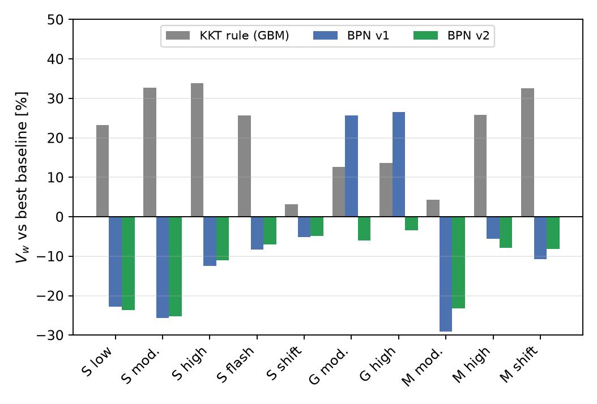

How to read the figure: bars are $V_w$ relative to the best baseline (below 0
is better). Grey (original KKT rule) is above zero almost everywhere, which is
the extended-study finding. Blue (BPN v1) wins on S and M but loses on G. Green
(BPN v2) is below zero in all ten.

### 11.8 B3: what is claimable and what is still needed

**Claimable**

* A controller that beats both strongest baselines, each in its best tuning,
  in all 10 scenarios of 3 families, on paired tests.
* Equal search effort, training seeds only; the baselines are special cases of
  the policy class.
* The learned exponent η explains when to reserve and when to back-pressure.
* 2.2–3.5 ms per decision in Python, inside the 10 ms interval (with the
  Bayesian forecaster it is about 20 ms, which is not).

**Still needed (say it before you are asked)**

* Real per-cell PRB or fronthaul traces.
* More baselines: a deep-RL xApp (PPO) with the same observations; Lyapunov
  drift-plus-penalty with deadline queues.
* Sensitivity of BPN to T, τ and load (so far only T = 20 slots = 10 ms and
  τ = 2 slots = 1 ms; the main deck writes these in slots).
* The policy is learned per traffic family; transfer between families is
  untested.
* No optimality proof for the hybrid; the KKT optimality only covers stage 2.

---

## 12. Limitations and what we do NOT claim

Say these **before** you are asked. Examiners respect a presenter who states
the limits.

1. **No real-world validation.** Three simulated families. Family G uses
   standard 3GPP models, but the round-robin scheduler and the single-link
   fronthaul model are ours. We know of no public per-slot, per-cell PRB
   traces (public O-RAN datasets such as ColO-RAN are 250 ms or coarser).
2. **Simplified link:** a budget-enforced pipe; no switch queue, one traffic
   class per cell, no HARQ (retransmissions), downlink only. A "violation" is
   an O-DU queueing deadline, not end-to-end latency.
3. **No closed-loop optimality or stability claim.** The propositions cover
   feasibility, equal weighted risk, backlog-first and a linear
   miscalibration bound, for one interval. BPN has no optimality proof.
4. **The KKT rule is not a universal win:** only −4 % against proportional
   under flash crowds; loses at T = 20 ms and at ≥ 0.86 load; near tie at
   τ = 5 ms; ML adds only about 2 % under the shift; calibration hurt.
5. **Priority trade:** the KKT-rule claim holds for an LL weight of at least
   2–3.
6. **Extended comparison:** CEM policy search and predictive MaxWeight beat
   the KKT rule in 9 of 10 scenarios; only BPN (B3) beats them, and it is
   learned per family at T = 10 ms, τ = 1 ms only.
7. **B2 Transformer:** Family S only; gains at high load are small (−1.4 %);
   the Bayesian layer is too slow in Python for a 10 ms interval;
   decision-focused training did not transfer. "No prior paper" means none
   found in our search, not a proof.
8. **Decision time** is 3.5 ms in Python for the KKT rule (2.2–3.5 ms for BPN);
   a real O-DU needs a compiled version.
9. The "oracle" is a **reference, not an upper bound**.

---

## 13. Slide-by-slide speaking guide

There are now two decks you may be asked to present from:

* **`presentation/part_b_final.pptx`** (and `part_b_final.pdf`): the
  dedicated **30-slide Part B deck**, with speaker notes on every slide. Built
  by `python presentation/make_part_b_pptx.py`. The guide below follows it.
* **`presentation/btp_final.tex` / `.pdf`**: the whole-project Beamer deck. Its
  Part B sections ("Part B", "Part B: Results", "Extended Study", "Part B2",
  "Part B3") contain the same material in more detail. If you present from it,
  the B1 slides map to slides 3–14 below, and its B2/B3 sections map to slides
  17–28.

| # | Slide | What to say (about 30–60 s each) | Land this |
|---|---|---|---|
| 1 | **Title** | Part A made the data smaller; Part B decides who sends how much when the link is too small. | |
| 2 | **Part B at a glance** | Four cards: B1 the KKT rule (NCC paper); the extended study found two stronger controllers; B2 tried a better forecaster and showed the gap is structural; B3 changed the structure and wins 10/10. | "Each step answers the question the previous one raised." |
| 3 | **The problem** | 8 cells (3 LL, 5 eMBB), 25GE link, C = 12.125 Mbit/slot, peak 2.44 C on purpose. Budgets every 10 ms on 1 ms old data. Why in advance: RIC ≥ 10 ms, switch shaping, DUs cannot coordinate in a slot. | "We must commit before we see the traffic." |
| 4 | **System model** | β(b) formula (Part A enters), demand = user bits ÷ η × β, budgets sum ≤ C, drops after D. V_w fixed before tuning. | "Load follows PRBs, not user bits." |
| 5 | *Section: B1* | | |
| 6 | **Key idea 1: r\*** | Smallest constant rate with no late bit. Long deadline → mean, short → peak. Example 8-unit burst: D = 1 → 4, D = 7 → 1. need = B + r\*. | "A single number is a poor basis for reserving a skewed quantity." |
| 7 | **Quantile forecaster** | 6 GBM models, 28 past-only features, 12 s, disjoint seeds; calibrated within a point; 37 % vs 52 % error. | "Well calibrated, cheap, CPU-only." |
| 8 | **KKT rule** | Newsvendor objective, concave, closed form r_i = B_i + F⁻¹(1 − λ/w_i); toy example λ = 0.6. | "Same weighted risk; margins derived, not tuned." |
| 9 | **Properties and loop** | Four propositions in plain words; walk the loop. | "One interval only; no closed-loop claim." |
| 10 | **Baselines and protocol** | Point forecast = key ablation; fixed quantile; oracles; margin 0 best for all. Families S and G; paired statistics. | "Fair by construction." |
| 11 | **B1 result, Family S** | Best implementable in all 5; paired box: −11 to −43 % vs median, every seed; weak −4 % vs proportional in flash crowds. | "Best in all five, and here is where it is weak." |
| 12 | **Where the gain comes from** | Unaware controllers starve LL; ours: lowest eMBB loss and highest utilisation in the deadline-aware family. | "Margin only where the forecast is wide." |
| 13 | **Ablations + Family G** | Range matters, per-cell level matters, ML useful not necessary, ACI hurt. Family G reproduces it. | "Most of the gain is the rule." |
| 14 | **Caveats and regime** | Weight sweep (needs w_LL ≥ 2–3), interval sweep (loses at 20 ms), A × B figure. | "Compression sets the regime; allocation decides the loss." |
| 15 | *Section: Extended study* | | |
| 16 | **Stronger controllers exist** | POMDP, three approximation families, Family M, theory (bounds 25–100× loose). CEM best in 6/10, predictive MaxWeight 3/10. λ\* ≥ w_eMBB in half the intervals. | "The gap is structural, not a constant." |
| 17 | *Section: B2* | "Can a better forecaster close the gap?" | |
| 18 | **LCQT architecture** | Walk the six blocks; red ones (cross-cell, Bayesian) are the unusual parts. Differentiable KKT layer at the bottom. 63k parameters, 6 min. | "Each block is prior art; the combination is ours." |
| 19 | **B2 forecast quality** | −4.5 % pinball, −8 % interval width at higher coverage; cross-cell layer no gain; Bayesian improves calibration under shift. | "A better forecast, but only modestly." |
| 20 | **B2 closed loop** | Bayesian LCQT best KKT variant: −20.8 / −6.1 / −1.4 % on 20/20 seeds; flash and shift n.s. CEM and pred. MaxWeight still 14–28 % better. | "The gap is structural." |
| 21 | **B2 honest assessment** | Improved vs did not; Bayesian layer 17–21 ms in Python. | "Keep the forecaster, change the structure." |
| 22 | *Section: B3* | | |
| 23 | **Why KKT loses to back-pressure** | Per-cell cap → reserved-but-unused capacity is lost; KKT 72.2 % utilisation vs BPN 76.1 %. | "Base by back-pressure, leftover by newsvendor." |
| 24 | **BPN design** | Two stages; η = 0 reservation, η = max back-pressure; contains both baselines exactly; CEM on training seeds, equal search effort; learned η recovers the regime map. | "The search can only match or beat the baselines." |
| 25 | **B3 result, Family S** | Same forecaster, BPN beats both everywhere; within 6–10 % of the oracle at high load; Transformer helps BPN more. Mention v1 vs v2 if asked. | |
| 26 | **Generalisation G and M** | v1 lost on G (cannot reserve); v2 fixes it; training costs. | "v2 generalises across all three families." |
| 27 | **BPN v2 vs best baseline** | Figure + paired table: 10/10 scenarios, all p ≤ 0.024. | "10 out of 10, three families." |
| 28 | **Claimable / still needed** | Read both columns. | "A controller that beats the strongest baselines, with its limits stated." |
| 29 | **Part B summary** | Read the table top to bottom: it is the story of Part B. | "Keep the structure, learn only what is uncertain, and let the search pick the structure." |
| 30 | **Limitations and future work** | Calmly read the limits; then next steps; thank the audience. | |

**Suggested 60-second opening for Part B:**

> "Part B is about sharing one fronthaul link between several cells. Operators
> deliberately buy a link smaller than the cells' total peak, because cells
> rarely burst together; in our setup the peak is 2.4 times the link. When
> bursts coincide, someone must lose data, and the controller has to decide in
> advance, every 10 milliseconds, on telemetry that is already a millisecond
> old, while low-latency cells can only wait 2 milliseconds. Our first method
> forecasts each cell's deadline-feasible rate as a range and splits the link
> with a closed-form rule that cuts every cell at the same priority-weighted
> risk; it is the best of twelve controllers in two traffic families. Our
> extended study then found two stronger controllers. We tried a better
> forecaster, a Bayesian Transformer, which helped only a little, so we changed
> the decision structure instead. The resulting back-pressure newsvendor beats
> both strongest baselines in all ten scenarios of three traffic families."

**Suggested 30-second close:**

> "Forecasting the deadline-feasible rate as a range and splitting the link
> with a KKT rule cut weighted violations by 11 to 43 percent against the same
> forecaster's median, and most of that came from the rule, not the machine
> learning. When stronger baselines appeared, a better forecaster was not
> enough; the gap was structural. A back-pressure base with newsvendor margins,
> learned with equal search effort, now beats the strongest baselines in ten
> out of ten scenarios, and the learned parameters tell us when to reserve and
> when to back-pressure. Next come real traces and a reinforcement-learning
> baseline."

---

## 14. Likely questions and honest answers

**The problem**

* **Q: What is the problem in one sentence?** Several cells share a fronthaul
  link smaller than their total peak; decide every 10 ms how much each may send,
  before knowing the next 10 ms of traffic.
* **Q: Why not decide every slot?** The coordination loop (near-RT RIC over E2)
  is ≥ 10 ms, switch shaping is not reconfigured per slot, and DU schedulers
  cannot consult each other within a slot. The interval sweep shows what
  happens from 2 ms to 20 ms.
* **Q: Could the DU just export its schedule?** Yes, where such an interface
  exists (e.g. CTI for PON fronthaul); then you do not need to forecast. Our
  setting is when budgets must be committed before the schedule is known.
* **Q: Why is fronthaul load not just user traffic?** 7-2x carries IQ per
  scheduled PRB; load = user bits ÷ spectral efficiency × 3,387 bits. Same user
  throughput can mean 2–3× different fronthaul load.
* **Q: What exactly is a violation?** Bits that wait in the DU queue longer
  than their class deadline (2 ms or 10 ms) are dropped and counted. It is a DU
  queueing deadline, not end-to-end latency.

**The method**

* **Q: What is new?** None of the ingredients alone (quantile boosting,
  constrained newsvendor/KKT, water-filling, conformal inference,
  network-calculus rates). The contribution is the **combination and its fair
  evaluation** in shared fronthaul: forecast r\* not volume, as a range, and cut
  every cell at the same weighted risk under the link constraint. Say "proposed
  method" or "candidate contribution", not "novel algorithm".
* **Q: Closest prior work?** Lagén et al. 2022 (shared 7-2x link, reactive
  per-slot compression control, no forecast). Bega et al. DeepCog/AZTEC
  (forecast-driven slicing, single number, no per-cell deadlines). Cohen et al.
  2023 (conformal prediction for one URLLC stream; our ablation shows
  per-stream correction does not carry over to coupled cells).
* **Q: Why forecast r\* and not traffic?** Because the deadline is what
  matters; for a 2 ms class r\* is the peak burst rate, which an average hides.
* **Q: Why a range and not one number?** r\* is skewed; one number under-serves
  bursts and a fixed margin wastes capacity (every positive margin was worse on
  validation).
* **Q: Is the allocation optimal?** Only for the one-interval surrogate
  (separable and concave, so KKT gives its global optimum). No closed-loop
  claim.
* **Q: Why gradient boosting and not an LSTM or a transformer?** Six models
  train in 12 s on a CPU, coverage within a point of nominal, and the ablation
  shows the model is not where most of the gain is. A sequence model is a
  possible improvement.
* **Q: Why ML at all?** Useful, not necessary. The window-quantile version
  already beats every baseline; ML adds 7–37 % on normal traffic, about 2 %
  under shift.
* **Q: Why did calibration (ACI) hurt?** LL misses in a coupled split are
  partly caused by the shortage split, not by forecast bias, so raising LL
  levels over-reserves LL and starves eMBB. Coupled calibration is future
  work.

**The evaluation**

* **Q: Any train/test leakage?** No. Disjoint seed ranges, forecaster frozen
  before testing, features from past slots only (unit-tested), normalisation by
  configuration constants, tuning on validation only, the shift scenario never
  seen in training or tuning.
* **Q: Why synthetic traffic?** No public per-cell, per-slot PRB fronthaul
  traces. That is why Family G is built purely from 3GPP models, and Family M
  from Markov models.
* **Q: Why are violation ratios so high (8–15 % at 0.8 load)?** Deliberately
  heavy-tailed bursts at 80 % mean load with budgets held 10 ms; even the
  oracle loses 13 % of eMBB bits. The paired differences are the result.
* **Q: Is the oracle an upper bound?** No. It is a perfect single-number
  forecast fed to water-fill. Our rule beats it at short intervals.
* **Q: Isn't the weighted metric chosen to favour you?** Fair question. We show
  the unweighted ratio and a weight sweep: proportional wins unweighted in
  Family S; our rule ties at w = 1 and leads from w = 3. The claim is scoped to
  operators who weight LL 2–3× or more.
* **Q: How were the baselines tuned?** Grid on validation seeds (margins,
  windows). Margin 0 was best for all; all redistribute unused capacity.
* **Q: Fairness and utilisation?** Jain's index > 0.98 for everyone; ours has
  the highest utilisation within the deadline-aware family (72 % vs 67–70 %).

**Failures and future**

* **Q: Where does it fail?** Flash crowds (only 4 % vs proportional),
  T = 20 ms (loses), τ = 5 ms (near tie), ≥ 0.86 load (loses), ML under shift
  (small gain), calibration (hurt), and in the extended study CEM and predictive
  MaxWeight beat it in 9/10 scenarios.
* **Q: If CEM is better, why present the KKT rule?** It has nothing to tune and
  a closed form with provable properties; CEM needs reward-driven training per
  setting. The extended study shows exactly where and why the stronger
  controllers win (decoupled class levels, back-pressure at long intervals with
  short bursts), and B3 uses that diagnosis to build a controller that beats
  them. The KKT rule survives inside BPN as stage 2.
* **Q: How expensive is it?** 3.5 ms per 10 ms interval in Python; the rule is
  < 0.1 ms; the cost is 1,800 trees. Compile it, shrink the model, or use the
  window fallback.
* **Q: How do Parts A and B connect?** β, the cost of one PRB-layer, is the
  compression setting. Compression moves the system along the load axis; the
  allocation decides the loss at that load.
* **Q: What is next?** Measured PRB traces; a deep-RL (PPO) xApp baseline and
  drift-plus-penalty; BPN sweeps over T, τ and load; cross-family transfer of
  the learned BPN policy; coupled calibration; a compiled O-DU implementation;
  the compression width as a per-cell knob inside the allocation rule.

**Part B2 (Transformer)**

* **Q: Why a Transformer at all, if ML was "useful, not necessary"?** To test
  whether the gap to the stronger controllers is forecast error. If a much
  better forecaster had closed it, the forecast was the problem. It did not
  (−1.4 % at high load vs a 14–28 % gap), so the problem is the decision rule.
* **Q: What is new in LCQT?** Each block is prior art (PatchTST patches,
  iTransformer-style cross-variate attention, FiLM, non-crossing quantiles, MC
  dropout, ensembles, decision-focused learning). The combination for a shared,
  deadline-constrained link (deadline-aware patch tokens, cross-cell attention
  over the cells on one link, a mixture fed to the KKT rule, and a
  differentiable KKT layer) is ours; we found no paper combining them.
* **Q: Did the cross-cell attention help?** No. Removing it changes neither
  forecast quality nor closed-loop results beyond noise. Say it plainly.
* **Q: Why feed a mixture and not averaged quantiles?** Averaging quantiles
  throws away disagreement between posterior samples; the mixture keeps it, so
  uncertain cells get wider margins at the same λ.
* **Q: Why did decision-focused training not help on test?** Its training cost
  covers one horizon and ignores how queues carry over between intervals; it
  helped under flash crowds (−1.2 %) but hurt at low load (+14 %).
* **Q: Is it fast enough?** LCQT alone: 2.7 ms per decision, faster than the
  GBM. With the Bayesian layer (24 forward passes): 17–21 ms in Python, longer
  than the 10 ms interval; it needs batching or compilation.

**Part B3 (back-pressure newsvendor)**

* **Q: What is BPN in one sentence?** Fill a base in back-pressure order, then
  spend the leftover capacity on newsvendor (KKT) margins.
* **Q: Why does the KKT rule waste capacity?** A budget is a per-cell cap;
  capacity reserved for an LL cell's upper quantile and not used is lost to
  everyone. BPN keeps the link busier (76.1 % vs 72.2 % utilisation).
* **Q: Isn't it unfair: 8 tuned parameters vs the baselines?** The baselines
  were re-tuned with the **same** CEM search on the same training seeds, and
  both are exact special cases of BPN (unit-tested). Test seeds were never used
  for tuning.
* **Q: Why v2 and not v1, when v1 is better on Family S?** v1 always uses
  strict back-pressure in stage 1, so it cannot express reservation and loses
  on Family G (long FTP bursts). v2 adds the sharing exponent η and wins all
  10 scenarios. On S, v1 is marginally better (5.23 vs 5.32 % at high load).
* **Q: What did the learned parameters tell you?** η = 6 (strict
  back-pressure) on bursty Family S, η = 0 (reservation) on Families G and M:
  the search rediscovered the regime map of the extended study.
* **Q: Is BPN optimal?** No proof. Only stage 2 inherits the KKT optimality
  for one interval.
* **Q: What is still missing before a top venue?** Real traces, a PPO xApp
  baseline, BPN sensitivity to T/τ/load, cross-family transfer.
* **Q: Where is this being published?** The conference version targets NCC
  2027 (IISc Bengaluru, Networks track; 6 pages, double-blind, so the
  submitted PDF is anonymised). An 11-page extended manuscript is in
  `paper/extended/`.

---

## 15. Cheat sheet: the numbers to remember

**Setup**

* 8 cells: 3 LL (2 ms, weight 3) + 5 eMBB (10 ms, weight 1)
* Link 25 Gbit/s; 3 % reserved; C = 12.125 Mbit per 0.5 ms slot
* β(BFP-9) = 3,387 bits per PRB-layer per slot; cell peak 7.4 Gbit/s
* Aggregate peak = 2.44 × C
* Control interval T = 10 ms (20 slots); telemetry delay τ = 1 ms (2 slots)

**Forecaster**

* 6 quantiles (5/25/50/75/90/95 %), 300 trees, 15 leaves, 28 features
* 101k rows, 12 s training
* Coverage 5.6 / 25.6 / 50.7 / 75.3 / 89.9 / 94.9 %
* Median error 37 % (vs 52 % persistence)

**Main results (Family S, 20 seeds)**

* Proposed V_w: 0.15 / 2.15 / 8.00 / 11.76 / 10.04 % (low / moderate / high / flash / shift)
* vs point forecast: −11 to −43 %, 20/20 seeds
* vs fixed global quantile: −22 to −54 %
* vs deadline-aware reactive: −19 to −70 %
* vs MaxWeight: −18 to −83 %
* vs reactive proportional: −4 % (flash) to −81 % (low)
* ML adds 7–37 % (2 % under shift)
* At high load: LL 3.4 %, eMBB 12.3 %, utilisation 72.2 %

**Family G (3GPP), high load**

* Proposed 8.01 %: −11 % vs point, −31 % vs deadline-aware, −50 % vs proportional; 20/20

**Forecast error share (oracle + KKT gap):** 24–40 % at high load

**Regime**

* T: wins at 2/5/10 ms; loses at 20 ms
* τ: margin over proportional 16 % → 2 % at 5 ms
* Load: allocation matters at 0.5–0.8; BFP 6/9/12/14 → 0.44/0.65/0.86/0.99
* Weight: needs w_LL ≥ 2–3

**Extended study**

* CEM best in 6/10, predictive MaxWeight 3/10, tuned-weight KKT 1/10
* Bound 25–100× conservative; λ\* ≥ w_eMBB in 50–58 % of intervals
* Decision time 3.5 ms (Python), rule < 0.1 ms

**Part B2 (Bayesian Transformer, Family S)**

* LCQT: 63k parameters, 16 patches × 22 slots, 2 layers, d = 48, ~6 min training
* Pinball −4.5 %, 90 % interval −8 % vs GBM, at higher coverage
* Bayesian LCQT + KKT: 0.12 / 2.02 / 7.89 / 11.78 / 10.02 %
* vs GBM + KKT: −20.8 / −6.1 / −1.4 % (20/20 seeds); flash, shift n.s.
* Cross-cell layer: no gain. Bayesian layer: 17–21 ms per decision

**Part B3 (back-pressure newsvendor)**

* Two stages: back-pressure base, KKT margins on the leftover; 8 parameters by CEM
* S high: BPN v2 5.32 % (v1 5.23 %) vs pred. MaxWeight 5.98 %, CEM 6.58 %, KKT 8.00 %
* Utilisation 76.1 % vs 72.2 % (KKT); eMBB loss 4.8 % vs 12.3 %
* G high 6.81 %, M high 3.62 %
* vs best baseline: −3.4 % (G high) to −25.3 % (S moderate); **10/10 scenarios, p ≤ 0.024**
* Learned η: 6 on S (back-pressure), 0 on G and M (reservation)
* Within 6–10 % of oracle + KKT at S high; 2.2–3.5 ms per decision

---

## 16. Glossary

* **O-RU / O-DU:** radio unit on the tower / processing unit nearby.
* **Fronthaul:** the link between them. **7-2x:** the O-RAN split where the
  O-RU sends IQ samples per scheduled PRB.
* **IQ samples:** complex radio samples (in-phase and quadrature).
* **BFP:** block floating point compression: shared exponent, short mantissa.
* **PRB:** physical resource block, 12 subcarriers × 1 slot; 273 per 100 MHz
  cell.
* **Layer / PRB-layer:** one MIMO stream / one PRB on one layer.
* **Spectral efficiency (η):** user bits per resource; depends on radio
  quality.
* **eCPRI:** protocol carrying IQ over Ethernet.
* **Near-RT RIC / E2:** O-RAN's near-real-time controller and its interface
  to the base station, running at 10 ms to 1 s.
* **Statistical multiplexing:** buying a link smaller than the total peak
  because peaks rarely coincide.
* **eMBB / LL:** broadband traffic (10 ms deadline) / low-latency traffic
  (2 ms deadline).
* **Deadline violation:** a bit dropped because it waited longer than its
  deadline.
* **V_w:** priority-weighted violation ratio, the main score.
* **r\* (deadline-feasible rate):** smallest constant rate that serves the
  coming arrivals with no bit late.
* **Backlog rate B_i:** the rate needed to clear what is already queued before
  it expires.
* **Quantile:** the value below which a given percentage of outcomes fall.
* **Pinball loss:** the loss function used to train quantile models.
* **Gradient boosting (GBM):** an ensemble of small trees, each correcting the
  last.
* **Calibration / coverage:** how often reality actually falls below each
  predicted quantile.
* **Newsvendor problem:** how much to stock under uncertain demand.
* **KKT conditions:** optimality conditions of a constrained optimisation
  problem.
* **λ (Lagrange multiplier):** the "price" of link capacity; one number for all
  cells.
* **Bisection:** halve an interval repeatedly to find the λ that makes budgets
  sum to C.
* **Water-fill:** fill needs in order (or proportionally) until the link is
  full.
* **MaxWeight / back-pressure:** serve the queues with the largest
  weight × length first.
* **Predictive MaxWeight:** MaxWeight with a look-ahead from the forecast.
* **ACI:** adaptive conformal inference: an online rule that widens or narrows
  forecast ranges after misses.
* **CEM:** cross-entropy method, a simple policy search from reward.
* **POMDP:** partially observed Markov decision process.
* **Effective bandwidth:** classical queueing quantity between the mean and
  peak rate of a source.
* **Paired comparison:** compare two controllers on the same seed, then
  aggregate the differences.
* **Bootstrap CI:** confidence interval obtained by resampling.
* **Wilcoxon signed-rank test:** a non-parametric test for paired data.
* **Holm correction:** adjusts p-values when many comparisons are made.
* **Jain's fairness index:** 1 means perfectly equal service ratios.
* **Transformer / attention:** neural network whose layers let each input
  element weigh all others; standard for sequences.
* **LCQT:** link-aware cross-cell quantile Transformer, the B2 forecaster.
* **Patch:** a chunk of consecutive time steps used as one Transformer token.
* **FiLM:** feature-wise scale-and-shift of a layer from side information.
* **MC dropout / deep ensemble:** two ways to estimate a model's own
  (epistemic) uncertainty: random neuron dropout at inference / several
  independently trained copies.
* **Mixture distribution:** the average of several CDFs; keeps disagreement
  between samples.
* **Decision-focused learning:** training a forecaster on the cost of the
  decision made with it.
* **Implicit function theorem:** lets you differentiate λ\* without
  differentiating through the bisection loop.
* **DAgger:** retraining on situations generated by the model's own decisions.
* **BPN (back-pressure newsvendor):** the B3 controller: back-pressure base,
  KKT margins on the leftover.
* **Sharing exponent η:** BPN's knob between reservation (η = 0) and strict
  back-pressure (η = 6).
* **Reservation vs back-pressure:** reserve each cell's need in advance /
  serve the most pressured queues first.

---

## 17. Where things live in the repository, and a live demo

| What | Where |
|---|---|
| Simulator, traffic, controllers, forecaster, KKT rule | `fhlm/` (`simulator.py`, `traffic*.py`, `controllers*.py`, `forecast.py`, `proposed.py`, `demand.py`) |
| Theory (extended) | `fhlm/theory.py`, `fhlm/theory_validation.py`, `fhlm/markov.py` |
| Tests | `tests/test_fhlm.py`, `tests/test_fhlm_extended.py` |
| All results (CSV, logs, figures) | `results/fhlm/`, figures in `results/fhlm/figures/` |
| Method with proofs | `docs/fhlm/method.md` |
| Results discussion | `docs/fhlm/results_summary.md`, `docs/fhlm/extended_study.md` |
| Literature review | `docs/fhlm/literature_review.md` |
| Reviewer-style critique and responses | `docs/fhlm/review_and_response.md` |
| Conference paper (NCC 2027, anonymised) | `paper/main.tex`, `paper/main.pdf` |
| Extended manuscript | `paper/extended/main.tex`, `paper/extended/main.pdf` |
| B2 Transformer forecaster | `fhlm/transformer.py`, `fhlm/train_transformer.py`, `fhlm/decision_focused.py`, `fhlm/eval_bayes_forecast.py`, `fhlm/run_transformer_study.py`; models `models/fhlm_lcqt_*.pt` |
| B3 back-pressure newsvendor | `fhlm/hybrid.py`; learned parameters `results/fhlm/hybrid_*.json` |
| B2/B3 results | `results/fhlm/transformer_summary.csv`, `transformer_runs.csv`, `transformer_paired*.csv`, `bayes_forecast_quality.csv`; figures `fig_transformer_*.png`, `fig_bpn_vs_best.png` |
| B2/B3 tests | `tests/test_fhlm_transformer.py`, `tests/test_fhlm_hybrid.py` |
| Part B slides | `presentation/part_b_final.pptx` / `.pdf` (built by `presentation/make_part_b_pptx.py`) |
| Whole-project slides | `presentation/btp_final.tex`, `presentation/btp_final.pdf` |

Every number in the papers is a LaTeX macro generated from the CSVs
(`fhlm/make_paper_tables.py`, `fhlm/make_extended_tables.py`), so text and data
cannot drift apart. That is a good point to make if asked about
reproducibility.

**Live demo (about 3 minutes, CPU only):**

```bash
pip install -r requirements.txt
python -m pytest tests/test_fhlm.py -q                 # link limit every slot, no future leakage, r* tight, ...
python -m fhlm.run_experiments demo --scenario high    # one trace, 3 controllers, ~10 s
python -m fhlm.make_figures                            # rebuild figures from saved CSVs
```

Expected order in the demo output: proposed < point forecast < deadline-aware
reactive. Then open `results/fhlm/figures/fig6_demo_timeseries.png` and explain
it as in Section 8.4.

**Full reproduction (if asked):** `python -m fhlm.train`, then
`python -m fhlm.run_experiments tune`, `main` (~12 min for 1,000 runs on 4
cores), `sweep`, `compression --scenario moderate`, and
`bash experiments/run_extended.sh` for the extended study (about 2 hours).
For B2 and B3: `python -m fhlm.train_transformer`, `python -m
fhlm.decision_focused`, `python -m fhlm.run_transformer_study` and
`python -m fhlm.hybrid cem --policy bpn2` (the Transformer parts need PyTorch).
